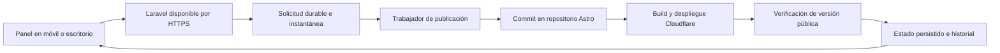

# Plan 2 — Publicación rápida y verificable desde el teléfono

Fecha: 28 de octubre de 2026. Revisión posterior a integrar `origin/DEV` hasta `94ed2c4` en la rama local `luis`. Estado: plan de implementación; la retirada de acceso y la nueva interfaz todavía no están implementadas. No se cambiaron cuentas ni despliegues públicos.

## Resultado esperado

Publicaciones será el centro de control de cada página: preparar, publicar, seguir el proceso, compartir, desactivar y retirar acceso cuando el cliente no continúe, y reactivar de forma explícita. El operador puede cerrar el navegador y retomar el resultado desde móvil o escritorio. Se mostrarán por separado la situación comercial, el acceso público vigente y la operación en curso. El panel y el procesador deben estar disponibles cuando el computador local esté apagado.

Una actualización de contenido fallida conserva la versión pública anterior. Una retirada fallida debe indicar que el acceso puede seguir disponible y ofrecer reintento; nunca presentar la página como retirada solo porque `activo` pasó a falso.

Complementa [el plan de panel web y móvil](PLAN_01_PANEL_WEB_MOVIL.md). Primero se conserva el flujo Laravel → GitHub → sitio Astro en Cloudflare y se mide. La cuenta, el proyecto de Cloudflare, su modalidad Pages/Workers y el checkout Astro conectado todavía deben verificarse; las medidas específicas de Pages son condicionales a esa comprobación.

## Diagnóstico basado en el repositorio

| Evidencia | Consecuencia y trabajo necesario |
| --- | --- |
| `PublicPagePublisher` crea blobs, árbol y commit; actualiza la rama con `force: false` | Ya hay publicación remota desde servidor; manejar conflictos de rama y resultados inciertos sin duplicar commits |
| La caché de blobs ya reutiliza contenidos durante una hora | Medir su eficacia y añadir comparación del manifiesto completo antes de crear un commit; no presentar la caché como una función nueva |
| La integración adapta `PublicationQueue` a solicitudes individuales pendientes en orden | No perder páginas al publicar individualmente; siguen pendientes historial durable por solicitud/revisión y recuperación para varias instancias |
| El código recibido publica una página individual y la combina con el contrato remoto | Reutilizar este avance; conservar las demás páginas y mostrar el alcance exacto de la acción |
| Publicar aparece para cualquier página activa, aunque la selección es limitada | Compartir la regla de elegibilidad entre UI, solicitud y trabajador |
| `publicada_en` se escribe al enviar el commit; `Ver página` admite estado `enviada` | Separar fecha de envío, despliegue y verificación; conservar acceso a una versión anterior sin anunciar que la nueva está disponible |
| Publicaciones solo consulta mientras hay pending/running | Añadir seguimiento del build y comprobación pública después del envío |
| Existen migraciones históricas de `publicaciones_sitio` y `detalles_publicacion` con operación, hash, destino y suspensión/reactivación | Auditar esquema efectivo y dependencias antes de reutilizarlo; evitar tablas duplicadas y no asumir que siguen presentes en cada instalación |
| Desactivar una página no elimina su entrada del contrato remoto; la cola rechaza inactivas | Crear operación específica de retirada, independiente de la elegibilidad para publicar |
| Eliminar un borrador conserva su página; una venta confirmada ya puede haber descontado tarjetas | Introducir rechazo/cancelación con historial y resolver retirada digital, stock y pagos por separado |
| Compose vincula el servidor web a `127.0.0.1:8080` | La instalación local descrita no ofrece por sí sola acceso desde la calle |

No se midieron tiempos reales ni se inspeccionó la cuenta de Cloudflare. La primera revisión fue estática; tras el pull se habilitó acceso al contenedor para validar la integración con pruebas aisladas. Esto no acredita comportamiento en producción ni en un teléfono físico. F12 y emulación no validan el bug reportado por el usuario.

## Publicaciones: especificación del front

| Superficie | Escritorio | Móvil físico |
| --- | --- | --- |
| Cabecera | Título, búsqueda por página/local/cliente/venta, filtros y contadores reales | Búsqueda visible y filtros compactos; conservar selección al regresar |
| Vistas | Todas, Pendientes, En proceso, Publicadas, Retiradas y Con error | Mismas capacidades; no ocultar acciones para ganar espacio |
| Cada registro | Nombre, local, venta, acceso vigente, cambios pendientes y última operación | Tarjeta con identidad, acceso actual y siguiente acción reconocibles sin abrir menú |
| Acción principal | Revisar y publicar, Ver seguimiento o Reactivar según estado | Botón visible de al menos 44 px; no depender de «Abrir acciones» para completar el flujo |
| Retirada | «Cliente no continúa / retirar acceso», con consecuencia y alcance explícitos | Confirmación breve con página/venta, motivo y botón inequívoco |
| Detalle | Ruta persistente, versión vigente/pendiente, cronología y enlaces a venta/editor/stock | Secciones apiladas, progreso por etapa y regreso que conserva el listado |

Mostrar «Público» junto con «Actualización fallida» cuando siga vigente una versión anterior; «Página desactivada · retirada pendiente» cuando la baja comercial ya se registró pero el sitio todavía no se comprobó. SHA y diagnóstico técnico irán en un bloque plegable. El frente principal usa etapas y tiempo transcurrido, sin porcentajes inventados.

Estados de diseño obligatorios: sin páginas, búsqueda sin resultados, cargando, sin conexión, permisos insuficientes, sesión vencida, trabajador detenido, build fallido, retirada fallida, operación sustituida y retirada confirmada. Cada estado indica la próxima acción. Un error de carga no se representa como listado vacío.

Publicaciones concentra la gestión digital; Crear venta, pagos, compra de tarjetas y ajustes físicos permanecen en sus módulos con navegación contextual. Desde una venta, «Cliente no continúa» abre el mismo flujo de retirada. No duplicar lógica de cancelación entre pantallas.

**Calidad visual exigida:** reutilizar shell y tokens ClickTap, un solo título, contraste correcto, nombres largos completos, sin desbordamiento desde 320 px, foco visible y botones alcanzables con teclado virtual. En escritorio se comparan registros; en móvil se prioriza una tarea por pantalla. Revisar antes/después en el teléfono afectado, también al abrir/cerrar sidebar, navegar por SPA y regresar de un modal. Las revisiones de tamaño de ventana sirven al layout, pero no sustituyen esa evidencia.

## Arquitectura propuesta

El teléfono envía contenido y consultas breves. El trabajo largo ocurre en el servidor y continúa al bloquear el dispositivo. Mantener PHP/Laravel en un alojamiento compatible siempre disponible, con almacenamiento, sesiones y trabajador persistentes. Un Tunnel puede conectar un origen existente, pero ese origen debe seguir funcionando: [documentación de Cloudflare Tunnel](https://developers.cloudflare.com/cloudflare-one/networks/connectors/cloudflare-tunnel/).

## Flujo visible y contrato de estados

1. **Revisar:** mostrar la página seleccionada, su venta, contenido guardado, diferencias relevantes y enlaces incompletos. Un lote futuro requerirá selección explícita y alcance visible.
2. **Confirmar:** fijar identificador de operación, usuario e instantánea/revisión; el servidor devuelve «En cola» solo tras persistir la solicitud.
3. **Continuar trabajando:** tarjeta de seguimiento en el panel y detalle en Publicaciones; no exigir permanecer en pantalla.
4. **Confirmar disponibilidad:** al verificar la versión pública mostrar hora, página afectada y acciones Ver y Compartir; para una retirada mostrar «Acceso retirado» solo tras comprobarla.
5. **Resolver un fallo:** explicar la etapa, conservar el contenido y ofrecer la acción apropiada: corregir datos, revisar conexión o reintentar el mismo trabajo.

| Estado | Evidencia requerida | Acción del operador |
| --- | --- | --- |
| Guardado / con cambios pendientes | Persistencia del editor; hash comparado con última versión publicada | Revisar y publicar |
| En cola | Trabajo persistido con identificador | Salir o consultar progreso |
| Preparando | Trabajador valida y prepara la instantánea | Seguir trabajando |
| Enviada | Commit confirmado en la rama esperada | Consultar seguimiento; no anunciar éxito público |
| Construyendo | Deployment del proyecto, entorno y commit correctos | Consultar avance |
| Verificando | Build/despliegue exitoso; comprobación del dominio en curso | Esperar resultado verificable |
| Publicada verificada | Versión esperada en producción y comprobaciones correctas | Ver y compartir |
| Fallida | Fallo conocido con etapa y código | Corregir o reintentar según causa |
| Pendiente de comprobación | Timeout o respuesta externa incierta | Reconciliar estado antes de repetir |
| Sustituida | Una versión posterior ocupa producción | Abrir la versión vigente; no atribuirla al trabajo anterior |
| Retirada pendiente | Baja comercial/desactivación e intención de retirada persistidas | Seguir proceso; el acceso anterior puede continuar disponible |
| Retirada fallida | Fallo conocido del bloqueo, build o verificación de retirada | Reintentar; indicar que el acceso sigue pendiente de eliminación |
| Retirada verificada | Dominio y rutas comprobadas ya no entregan el contenido | Conservar historial; reactivar solo por acción explícita |

No deducir el resultado por «último deployment». Correlacionar proyecto, rama, entorno de producción y SHA. La API de Pages expone los despliegues y su información: [List Pages deployments](https://developers.cloudflare.com/api/resources/pages/subresources/projects/subresources/deployments/methods/list/). Si el proyecto usa Workers, implementar el adaptador de seguimiento apropiado tras confirmar su configuración.

## Cliente no continúa: regla comercial y retirada de acceso

«Eliminar acceso» significa que la URL pública, sus alias y los destinos de QR/NFC dejan de entregar la página. Conservar contenido administrativo, slug e historial. No se ha identificado una cuenta de cliente vinculada: no desactivar usuarios operadores por este flujo. Si existen enlaces compartibles de propuesta, incluir su revocación explícita.

| Situación | Acción comercial | Página/acceso | Stock y dinero |
| --- | --- | --- | --- |
| Borrador sin página | Marcar rechazado con motivo y autor | No hay retirada remota | Sin movimientos inventados |
| Borrador con página inédita | Conservar vínculo y rechazo | Desactivar y revocar propuestas compartibles, si existen | Sin descuento ni devolución de stock |
| Borrador con página publicada | Conservar venta e historial | Desactivar y solicitar retirada verificable | Resolver reservas reales, si existen |
| Venta confirmada | Cancelación trazable, manteniendo detalle original | Retirar acceso de la página correspondiente | Reembolso y recepción física se registran aparte; no sumar tarjetas aún entregadas |
| Reserva con abono | Resolver saldo y liberación según reglas de negocio | La retirada digital sigue su propia operación | No reutilizar a ciegas `cancelOrder`, que hoy exige reserva sin saldo cobrado |

Implementar con bloqueo de venta/página, ID idempotente, motivo, autor y fecha. Persistir desactivación e intención de retirada junto con un evento pendiente en la misma transacción; ejecutar GitHub/Cloudflare fuera de ella. Así una caída no pierde la retirada ni bloquea una transacción durante llamadas externas.

La retirada elimina el slug del contrato generado o registra una exclusión explícita que Astro aplica antes que rutas históricas. Revisar páginas codificadas individualmente, alias, redirecciones, índices y sitemap: omitir una entrada del JSON no basta si otra ruta sigue generando contenido. Permitir retirada aunque la página esté inactiva o fuera de la selección actual de publicación.

Para revocación rápida sin esperar a un build, evaluar un control de acceso antes de entregar contenido estático, con estado de revocación confirmado. El diseño deberá cubrir dominio propio y URLs alternativas públicas, incluidos despliegues anteriores accesibles; de lo contrario no se afirmará revocación completa. Hasta disponer de ese mecanismo, mostrar «Retirada pendiente» durante despliegue y comprobación. No prometer eliminación inmediata al tocar el botón.

Una publicación anterior al rechazo no puede restablecer acceso. Usar una revisión de visibilidad al despachar, activar y reconciliar trabajos. Un rollback también respeta retiradas posteriores. Reactivar exige revisar la situación comercial, acción explícita y nueva comprobación; guardar o publicar otra página no reactiva la retirada. Mantener el slug reservado al mismo negocio.

Antes de reembolsos, conciliar `precio_recibido_clp` con pagos efectivamente registrados: ese campo no acredita por sí solo un cobro en el libro. Reintegrar tarjetas únicamente mediante recepción/devolución física válida, trazable y sin duplicados.

## Entregas de implementación

### A. P0 — Medir y hacer inequívoca la publicación

1. Registrar la configuración efectiva: repositorio/rama, proyecto Cloudflare, dominio, comando de build, directorio de salida, versión de Node/Astro y build cache. No registrar tokens.
2. Instrumentar los tiempos de solicitud, espera en cola, exportación, GitHub, espera de build, build, despliegue y verificación pública. Asociarlos al mismo ID de operación.
3. Capturar manifiesto canónico e instantánea de la página solicitada, preservando las demás del contrato remoto. Separar campos volátiles para que timestamps no generen cambios artificiales.
4. Guardar alcance, hash, commit y fechas de cada etapa. Migrar `publicada_en` histórico sin convertir envíos anteriores en publicaciones verificadas; clasificarlos como pendientes de comprobación.
5. Aplicar selección antes de publicar y al ejecutar; mantener un camino separado para retirada, incluso fuera de selección. Mostrar alcance real y estados comercial/público independientes.

**Cierre:** se puede explicar qué contenido se envió, quién lo pidió y cuánto tardó cada etapa; nunca se marca publicada una revisión solo por enviarla a GitHub.

### B. P1 — Cola durable, reintentos y seguimiento

1. Auditar migraciones de `publicaciones_sitio`, `detalles_publicacion`, dependencias de versiones y esquema real de cada entorno. Reutilizar o evolucionar estructuras para trabajos persistidos con historial y cola durable de Laravel; evitar un esquema paralelo. Mantener identificadores tras reinicio o cambio de instancia.
2. Idempotencia por destino, página, tipo de operación, revisión de visibilidad y hash. Un doble toque reutiliza el trabajo; contenido distinto crea otra revisión. Conservar solicitudes individuales. Un lote futuro solo agrupa operaciones compatibles; retirada y reactivación no son el mismo trabajo.
3. Serializar escrituras por repositorio/rama. Ante conflicto, releer HEAD y reconstruir sobre el nuevo árbol con intentos acotados; no forzar la rama. Ante timeout tras escribir, consultar GitHub antes de crear otro commit.
4. Seguir Cloudflare desde el servidor con espera creciente, jitter, límites de tiempo y tratamiento de 429/5xx. Ejemplo inicial: 5, 10, 20 y 30 segundos; detener seguimiento activo al llegar a estado terminal. Ajustar con mediciones y límites de la cuenta.
5. El navegador consulta estado persistido solo cuando la vista esté activa; el servidor continúa con el navegador cerrado. Mostrar heartbeat del trabajador y distinguir cola detenida de build lento.
6. Introducir manifiesto público de versión sin datos privados y comprobar el dominio personalizado, página afectada, logo y enlaces esenciales. Usar marcador inyectado por build/identificador de publicación para evitar depender de una respuesta HTTP 200 que puede contener contenido anterior.
7. Impedir que un resultado tardío sobrescriba una publicación nueva. Asociar el estado de cada página a la revisión realmente incluida; cambios guardados durante el build permanecen «pendientes de publicar».

**Cierre:** cerrar navegador, reiniciar trabajador y repetir una solicitud no pierde seguimiento ni duplica operaciones. Un fallo de actualización conserva la versión anterior; un fallo de retirada muestra acceso pendiente de eliminación, sin afirmar una baja pública inexistente.

### C. P0/P1 — Centro Publicaciones y rechazo comercial

1. Implementar listado/detalle especificados sobre consultas paginadas, búsqueda, filtros, contexto de venta y acciones según estado. Acceso vigente y operación actual permanecen independientes.
2. Construir «Cliente no continúa» compartido por Ventas y Publicaciones: identificar venta/página, mostrar consecuencias, registrar motivo, desactivar, preservar vínculo y encolar retirada.
3. Implementar retirada del contrato y sus rutas, protección contra trabajos antiguos, reintento idempotente y comprobación pública.
4. Actualizar etiquetas comerciales de Ventas; «todo lo no confirmado es borrador» no admite rechazo/cancelación correctamente.
5. Integrar retorno a venta, editor y movimientos existentes. Devoluciones y pagos usan operaciones de negocio específicas, sin reintegros automáticos de inventario por retirar una página.
6. Entregar reactivación deliberada con confirmación y nueva publicación. Ocultar detalles técnicos secundarios sin ocultar errores ni consecuencias.

**Cierre:** venta → página → publicación → cliente no continúa → retirada comprobada se completa desde Publicaciones y Ventas, conserva historial y no genera stock ni reembolsos ficticios. No hay reactivación accidental.

### D. P1 — Reducir el tiempo y el número de builds

| Medida | Implementación | Validación |
| --- | --- | --- |
| Evitar publicaciones idénticas | Comparar manifiesto/árbol con destino antes de crear commit | Publicar sin cambios genera cero builds y devuelve referencia a la versión vigente |
| Reutilizar archivos | Mantener caché de blobs existente; medir y usar nombres con hash para recursos que cambien | Una modificación de texto no vuelve a subir todos los logos; cambiar logo evita recursos obsoletos |
| Agrupar solo si aporta mejora medida | Optimización posterior, ventana configurable de 3–5 s con instantáneas, IDs y operaciones compatibles | Ninguna solicitud se pierde; retirada prioritaria no espera a publicaciones ajenas |
| Cachear build | Si es Pages, habilitar y verificar caché de dependencias y Astro | Comparar builds fríos y calientes con el mismo cambio |
| Omitir builds irrelevantes | Configurar rutas observadas de contenido, recursos, código y lock/configuración | Cambios solo documentales no construyen; contenido o plantilla sí |
| Limitar peso público | Optimizar logos/imágenes y evitar JavaScript en bloques estáticos; medir antes/después | Página legible pronto en 4G sin perder interacciones |
| Evitar disparadores duplicados | Elegir el mecanismo efectivo Git o pipeline explícito | Un commit no activa a la vez integración Git y deploy hook redundante |

Cloudflare documenta caché para Astro y dependencias: [Build caching](https://developers.cloudflare.com/pages/configuration/build-caching/). Las reglas de rutas deciden si disparar un build, no convierten el build de Astro en incremental: [Build watch paths](https://developers.cloudflare.com/pages/configuration/build-watch-paths/). Comprobar que ninguna exclusión oculte los archivos generados de publicación.

**Cierre:** informe comparable de al menos diez ejecuciones representativas, separando caché fría/caliente y texto/logo/cambios múltiples. Objetivo inicial: reducir al menos 30 % la mediana de publicación equivalente frente a la línea base; si no se alcanza, identificar la etapa dominante y decidir la siguiente mejora. Es una meta, no un tiempo garantizado por Cloudflare.

### E. P1 — Disponibilidad real y recuperación

1. Preparar aplicación y trabajador en un host siempre disponible; imagen reproducible, recursos compilados, health checks, sesiones y archivos persistentes, secretos exclusivamente en servidor. No depender de montajes OneDrive para operación remota.
2. Configurar HTTPS, dominio del panel, autenticación y reglas de caché que excluyan páginas privadas y solicitudes Livewire. Comprobar URLs de upload, cookies, CSRF y proxy para móvil.
3. Si se mantiene copia local de Supabase, compartir/invalidatear el estado como corresponda y mostrar su antigüedad. Medir región y latencia de escritura; no confirmar una escritura solo en la copia de lectura.
4. Conservar versión pública anterior e historial de despliegues. Ofrecer restauración autorizada con resumen de páginas afectadas; distinguir rollback del sitio de restauración de datos de negocio.
5. Probar rollback en staging, verificar dominio y reconciliar el panel. Respetar retiradas vigentes aun al recuperar contenido anterior; un rollback no puede reabrir páginas rechazadas. Las siguientes publicaciones parten de la intención vigente. Pages admite volver a despliegues de producción elegibles: [Rollbacks](https://developers.cloudflare.com/pages/configuration/rollbacks/).
6. Alertar sobre trabajador sin heartbeat, cola antigua, fallo de build, comprobación pública pendiente y repetición de errores. Mostrar información útil al operador y logs técnicos solo donde corresponda.

**Cierre:** desde datos móviles y con el PC local apagado se puede autenticar, guardar, solicitar publicación, cerrar el navegador y recuperar el estado final. Este recorrido debe probarse realmente antes de anunciar disponibilidad para trabajo en la calle.

## Presupuesto de rendimiento y pruebas

Separar velocidad del panel, duración del despliegue y carga del sitio público. Medir en dispositivo, red, dataset y región documentados. Objetivos iniciales de ingeniería, sujetos a ajuste tras línea base:

- Feedback local al tocar: menos de 150 ms; confirmación de solicitud persistida: p95 menor de 2 s bajo el perfil de red acordado.
- Despliegue: reducción de mediana de al menos 30 % para cambios equivalentes; reportar p50/p95 y los casos lentos, sin prometer segundos fijos antes de medir.
- Detección de deployment terminado: dentro del siguiente intervalo de sondeo más la comprobación pública; nunca afirmar disponibilidad global desde una sola comprobación.
- Sitio público móvil: objetivos LCP ≤ 2,5 s, INP ≤ 200 ms y CLS ≤ 0,1 al p75 cuando exista muestra de campo suficiente; mientras tanto reportar pruebas de laboratorio como tales. Referencia: [Core Web Vitals](https://web.dev/articles/vitals).
- Fiabilidad: cero duplicados en pruebas de doble toque/reintento; cero éxitos falsos ante 403, 429, timeout, fallo de build o contenido público antiguo.

Ampliar `PublicationQueueTest`, `PublicPagePublisherTest`, `PublicPageExportTest` y `PublishedPageTemplateTest` según la entrega. Usar HTTP simulado para GitHub/Cloudflare y base aislada para transiciones, concurrencia, revisiones y reinicios. Integrar pruebas de navegador del plan 1 para solicitar y recuperar seguimiento.

Casos indispensables: publicación idéntica, individual sin modificar otras páginas, varias solicitudes sin pérdida, página excluida, retirada fuera de selección, rechazo con/sin página pública, venta confirmada sin devolución física, reserva con abono, dos operadores simultáneos, HEAD cambiado, timeout tras commit, despliegue ajeno, build fallido, retirada durante build, respuesta pública antigua, guardado durante build, caída del worker, navegador cerrado, reactivación explícita y rollback que respeta retiradas. Verificar URL principal, alias, destinos QR/NFC y rutas alternativas. La integración remota se valida en staging sin tocar producción.

Para el front, priorizar el teléfono físico donde falla «Abrir acciones». No exigir suites iPhone/Android emuladas equivalentes a F12 ni presentarlas como prueba del arreglo. Mantener pruebas de servidor y regresiones generales; sin móvil real, registrar la validación física como pendiente.

## Evolución condicionada por mediciones

Si el build completo sigue siendo el cuello de botella y se requiere actualización de contenido en pocos segundos, realizar una prueba acotada que separe contenido publicado versionado del despliegue de código. Evaluar renderizado/entrega desde Workers con caché e invalidación por versión. Debe definir snapshot público, consistencia, coste, disponibilidad del origen, fallback y rollback; el sitio no leerá directamente los borradores editables.

Workers puede distribuir recursos estáticos junto al código: [Static Assets](https://developers.cloudflare.com/workers/static-assets/). Esa capacidad por sí sola no garantiza publicación instantánea. La migración quedaría como decisión posterior con comparación medida, compatibilidad de Astro verificada y continuidad de URLs QR/NFC. La ruta inicial es optimizar el sistema actual.

## Orden, esfuerzo y dependencias

| Entrega | Esfuerzo orientativo | Dependencia |
| --- | --- | --- |
| A: línea base y contrato | 1–2 jornadas | Configuración real y repositorio Astro verificables |
| B: persistencia y seguimiento | 3–5 jornadas | A, acceso API adecuado y staging |
| C: Publicaciones, rechazo y retirada | 3–5 jornadas | A/B, esquema comercial y rutas Astro identificados |
| D: optimización | 1–3 jornadas | A/B y series comparables |
| E: disponibilidad y recuperación | 2–4 jornadas | Host de destino y validación del flujo completo |

Total orientativo: 10–19 jornadas, sin incluir provisión externa ni evolución opcional a contenido dinámico. La interfaz de Publicaciones del plan 1 es la misma entrega, no trabajo duplicado. Priorizar A/B/C junto con reparación táctil y ventas/stock; después optimizar y validar operación remota.

Dependencias pendientes de comprobar: proyecto Pages/Workers, repositorio y rama efectivos, dominio de staging, capacidades de la cuenta, alojamiento de Laravel y almacenamiento. Revisar esos datos al comenzar la implementación; no son necesarios para entregar estos planes. Mantener como referencia [modularización y nube](PLAN_MODULARIZACION_NUBE.md) y [Supabase/Astro](PLAN_INTEGRACION_SUPABASE_ASTRO.md), conciliando cualquier propuesta antigua con el código y la configuración vigentes.

## Base integrada y verificación del 28 de octubre

Se incorporaron seis commits de `origin/DEV` en `luis` hasta `94ed2c4`, preservando el trabajo local y resolviendo tres conflictos del autostash. La publicación individual conserva contenido remoto ajeno y valida el contrato leído desde el mismo HEAD. La cola conserva solicitudes de páginas distintas, deduplica pendientes de la misma página y procesa una por ejecución; los mensajes del panel indican alcance individual.

Pasaron 42 pruebas (390 aserciones) de `PublicPagePublisherTest`, `PublicationQueueTest`, `PublicPageExportTest`, `PublishedPageTemplateTest` y `AdminPanelTest`, con SQLite en memoria y HTTP simulado. PHPUnit avisó que no pudo guardar su archivo de caché de resultados; no afectó a las aserciones. Pint pasó sobre los archivos PHP modificados mediante lista explícita porque el contenedor no monta `.git` y no admite `--dirty`.

La migración de bancos de transferencia ya figuraba aplicada. Se reinició el trabajador de publicaciones tras comprobar que no había solicitudes pendientes ni en curso. Esta verificación corresponde a la integración del código recibido.

## Avance de implementación posterior

Se implementaron el centro de Publicaciones, rechazo comercial con auditoría, desactivación de página, retirada del contrato generado y de archivos Astro de ruta directa, reactivación explícita y recuperación de intenciones de retirada pendientes si se pierde una entrada de la cola local. La retirada comprueba la URL principal y los alias históricos. El seguimiento opcional de Cloudflare Pages correlaciona el SHA del despliegue de producción y sondea el dominio; solo entonces marca la página como publicada o retirada. El panel distingue envío al repositorio de acceso público comprobado.

Las credenciales y el proyecto Cloudflare no están configurados en el entorno local, así que no se ejecutó una publicación real ni se validó el despliegue en staging. La cola usa almacenamiento local de caché y aún requiere persistencia compartida para múltiples instancias. El panel Laravel todavía depende del PC local; sigue pendiente elegir y configurar alojamiento siempre disponible, mediciones de tiempo reales, prueba de móvil físico y comprobación de rutas alternativas de despliegue antes de afirmar retirada total.
