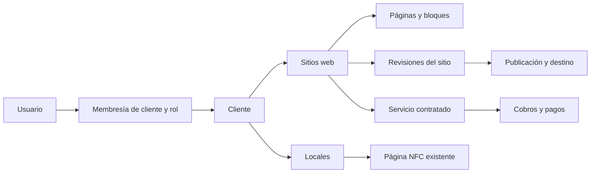

# Plan 3 — Gestión web y landing pages para clientes

Fecha: 29 de octubre de 2026. Estado: propuesta de producto e implementación; no se ha implementado ni desplegado este módulo.

Modalidad confirmada: **mixta**. ClickTap crea la web y configura su diseño; el cliente puede editar su contenido y solicitar ayuda. La primera entrega comercial será una landing editable. La web de varias páginas será una ampliación del mismo módulo.

## Producto y oferta comercial

El módulo se llamará **Sitios web** en el panel interno y **Mi web** en el portal del cliente. Permitirá vender diseño inicial, alojamiento y mantenimiento como un servicio recurrente, con una relación clara entre cliente, sitio, servicio contratado y cobros.

| Oferta propuesta | Entrega | Operación |
| --- | --- | --- |
| Landing de negocio — primera entrega | Una página adaptable a móvil, plantilla personalizada, servicios, imágenes y contacto | ClickTap prepara y entrega; el cliente actualiza contenido |
| Web de negocio — ampliación | Inicio, nosotros, servicios y contacto; cantidad de páginas según contrato | Mismo portal, editor y sistema de publicación |
| Landing de campaña — ampliación | Página adicional para una promoción, evento o campaña | Fecha y objetivo propios; contratación adicional |
| Mantenimiento asistido — complemento | Cambios realizados por ClickTap, soporte y seguimiento | Cupo y plazo de respuesta definidos en el contrato |

Separar el **tipo de sitio** de la **modalidad de gestión** y de los **límites contratados**. Una landing también puede incluir mantenimiento asistido. Las páginas de enlaces NFC existentes conservan su producto y sus rutas.

Propuesta de cobro: implementación inicial + mantenimiento mensual o anual + extras cotizados. Registrar por separado dominio, páginas adicionales, cambios de diseño y trabajo fuera del cupo. La edición de contenido por el cliente queda incluida dentro de los límites de su servicio. Los importes en CLP se definirán a partir del costo de implementación, alojamiento y atención; este plan no fija precios de mercado.

Para el piloto, proponer un sitio, una landing, un propietario y un editor por contrato. Hacer configurables cantidad de páginas, almacenamiento, usuarios y solicitudes asistidas. Definir qué cuenta como un cambio, revisiones incluidas y plazo de atención antes de venderlo. Registrar cobros y pagos manualmente al inicio; la cobranza automática queda para una ampliación.

Si el cliente ya tiene una web externa, comenzar con una evaluación y propuesta de migración o mantenimiento asistido. El editor de ClickTap administrará contenido creado en su propio sistema. La edición directa de WordPress u otros proveedores necesitará una integración específica y no forma parte de la primera entrega.

## Base existente y cambios necesarios

La revisión se realizó sobre los archivos de trabajo, incluidos cambios locales previos. No se inspeccionaron el esquema de producción ni el repositorio Astro externo. Las migraciones indican el diseño del repositorio, no demuestran el estado de todos los entornos.

| Situación comprobada | Evidencia | Consecuencia |
| --- | --- | --- |
| Editor de datos, enlaces, apariencia y preview | `src/app/Models/Pagina.php`, `src/app/Data/PaginaPublica.php`, `src/routes/web.php` | Reutilizar validadores y componentes compatibles |
| Publicación y retirada con seguimiento | `PublicPagePublisher.php`, `PublicationQueue.php`, `CloudflareDeploymentTracker.php` | Evolucionar el servicio existente para sitios y revisiones |
| Acceso basado en usuario activo | `src/app/Models/User.php`, `src/app/Policies/PaginaPolicy.php` | Incorporar roles y propiedad antes de invitar clientes |
| Una página por local | `LocalNegocio::pagina()` y restricción única de `paginas.local_id` | Crear el concepto Sitio con sus páginas, preservando el modelo NFC |
| Contenido vigente guardado en `paginas` | `README.md`, migración `2026_10_10_210000_simplify_page_content.php` | Los borradores persistentes y versiones editoriales son trabajo nuevo |
| Tablas históricas de versiones, solicitudes, cobros y publicaciones | Migraciones de octubre de 2026 | Auditar uso y datos antes de reutilizar o evolucionar; tabla existente no equivale a función terminada |
| Ventas y artículos asociados al inventario | `Ventas.php`, `BusinessLedger.php`, migración de `ventas` | Contratar servicios web sin crear movimientos ficticios de tarjetas |
| Réplica local limitada a cuatro tablas | `LocalCatalogSync::TABLES` | Definir explícitamente dónde se leen y escriben las nuevas entidades |
| Panel local y cola en un almacén local de publicaciones basado en archivos, separado de la caché habitual | `README.md`, `PublicationQueue.php`, `docs/PLAN_MODULARIZACION_NUBE.md` | Completar alojamiento permanente y persistencia antes de ofrecer acceso remoto |

El [plan del panel web y móvil](PLAN_01_PANEL_WEB_MOVIL.md) y el [plan de publicación](PLAN_02_PUBLICACION_CLOUDFLARE.md) siguen siendo dependencias compartidas. Reutilizar sus entregas ya verificadas y presupuestar solo lo pendiente.

## Experiencia del cliente y del equipo

**Portal del cliente, ruta propuesta `/cliente`:** inicio con su web y estado público; editor de contenido; vista previa; publicaciones e historial; solicitudes de cambios; servicio contratado y cobros propios. Si tiene varios sitios, mostrar un selector restringido a los autorizados. En móvil, un bloque por pantalla y acciones Guardar y Vista previa siempre alcanzables.

**Panel interno `/admin`:** listado de sitios con cliente, tipo, servicio, última publicación, cambios pendientes y solicitudes abiertas. Desde el detalle se accede al diseño, usuarios autorizados, contrato, cobros y publicación. Conservar Publicaciones como centro operativo, con filtros por sitio y destino.

| Acción | ClickTap | Propietario del cliente | Editor del cliente |
| --- | --- | --- | --- |
| Crear sitio, elegir plantilla y definir estructura | Sí | Solicita | Solicita |
| Editar textos, fotos, horarios y promociones | Sí | Sí, en sus sitios | Sí, en sus sitios |
| Añadir bloques estructurales o cambiar diseño | Sí | Solicita | Solicita |
| Guardar y previsualizar borrador | Sí | Sí | Sí |
| Aprobar contenido y publicar | Sí, con trazabilidad | Sí, tras la entrega del sitio | Solicita revisión |
| Dominio, DNS y destino de publicación | Sí | Consulta y aporta acceso autorizado | No |
| Ver contrato y cobros | Sí | Solo los propios | No |
| Invitar o revocar usuarios | Sí | Solicita a ClickTap en el piloto | No |

La primera publicación la realiza ClickTap después de la aprobación del propietario. Tras la entrega, el propietario puede publicar cambios de contenido dentro de la estructura permitida. Los cambios asistidos de diseño requieren nueva revisión. Registrar qué revisión fue aprobada: los cambios posteriores requieren aprobación de otra revisión y no modifican la aprobación de una publicación ya solicitada.

Recorrido de entrega: registrar cliente y servicio → crear sitio desde plantilla → cargar contenido → invitar al propietario → revisar preview privada → aprobar revisión → publicar y comprobar → entregar acceso y guía breve.

Recorrido cotidiano: entrar a Mi web → editar horario o promoción → guardar borrador → revisar vista previa → publicar → ver la revisión disponible. Si necesita otro diseño, envía una solicitud con descripción y adjuntos y ve su estado.

## Alcance de la primera entrega

1. **Acceso por invitación:** aceptación con vencimiento y uso único, verificación de correo, recuperación de contraseña y cierre de sesión. Sin registro abierto durante el piloto.
2. **Editor de bloques acotados:** portada, presentación, servicios, galería, testimonios, preguntas frecuentes y contacto/WhatsApp. ClickTap fija la estructura; el cliente modifica los campos habilitados. Dos plantillas iniciales, para negocio local y servicios profesionales.
3. **Medios y apariencia:** logo, fotografías, textos alternativos y paleta elegida por ClickTap. Límites de tamaño, tipo y cantidad, optimización de imágenes y biblioteca del propio cliente. Recursos de borradores privados; publicar solo los incluidos en la revisión aprobada.
4. **Borrador y preview:** guardado persistente, advertencia de cambios sin guardar y vista de móvil/escritorio. Preview autenticada; enlace externo revocable y con vencimiento solo si se necesita para aprobar antes de activar una cuenta.
5. **Publicación e historial:** cambios pendientes, revisión solicitada, progreso, fallo recuperable y revisión pública verificada. Restaurar una revisión crea un nuevo borrador que se revisa y publica.
6. **SEO básico:** título, descripción, imagen al compartir, URL canónica y sitemap del sitio publicado. Preview fuera de indexación y acceso restringido. Sin promesas de posicionamiento.
7. **Atención asistida:** solicitud → revisión de alcance/costo → en proceso → aprobación → publicación verificada → completada. Adjuntos privados y comunicación dentro del portal. Un extra con costo requiere aceptación registrada antes de ejecutarlo.
8. **Servicio y cobros:** fecha de alta, período, renovación, límites y pagos manuales conciliados. El propietario ve su información comercial; el editor no accede a ella.

El contacto inicial será por WhatsApp, teléfono y correo. Formularios con bandeja de prospectos y métricas de visitas/conversiones se incorporarán en la segunda entrega, con endpoint de recepción, validación, protección contra abuso, retención y permisos definidos. Un clic en WhatsApp se medirá como clic, no como venta ni conversación confirmada.

La primera entrega no incluye tienda, reservas, blog, generación automática de contenido, constructor visual libre, HTML/JavaScript aportado por clientes ni conectores de CMS externos.

## Arquitectura propuesta

Mantener Laravel y Filament para ambos paneles, y Astro para la salida pública. Filament 3 admite paneles separados con recursos propios; el control de acceso debe distinguir el panel y autorizar también los registros. [Configuración de paneles](https://filamentphp.com/docs/3.x/panels/configuration) y [autorización de usuarios](https://filamentphp.com/docs/3.x/panels/users).

La guía de diseño ClickTap aporta colores, tipografía, contraste y criterios móviles. Este módulo no depende de migrar a React. La conveniencia de actualizar dependencias se revisará por separado al iniciar implementación, usando las versiones efectivamente instaladas.

Modelo conceptual:

| Entidad propuesta | Responsabilidad y regla |
| --- | --- |
| Membresías usuario–cliente | Rol y acceso vigente; unicidad de la relación. Personal interno identificado por permisos propios |
| `sitios_web` | Dueño `cliente_id` obligatorio, local opcional, tipo, nombre, plantilla, estado de entrega y destino. Si tiene local, debe pertenecer al mismo cliente |
| `paginas_sitio` | Sitio, ruta relativa, orden y contenido estructurado de bloques. Ruta única normalizada por sitio; una portada |
| `revisiones_sitio` | Snapshot inmutable de páginas, navegación, estilos y referencias de medios; versión de esquema, autor, hash y aprobación |
| Medios del sitio | Propiedad, tipo, tamaño, ubicación y referencias desde revisiones. Reutilizar `archivos` solo tras auditar su contrato y almacenamiento |
| Dominio/destino | Sitio, hostname normalizado único, verificación, estado de certificado y proyecto de publicación; secretos en servidor |
| `servicios_web` | Cliente/sitio, modalidad, importes y límites contratados como snapshot, período y renovación. Un cambio de tarifa no modifica contratos anteriores |
| Solicitudes, cobros y publicaciones | Evolucionar tablas existentes con referencias al sitio/revisión y compatibilidad con registros anteriores |

La separación `paginas_sitio`/`revisiones_sitio` es deliberada: las tablas `paginas`/`versiones_pagina` están ligadas al producto NFC y a un local. No renombrarlas ni migrar todas las páginas NFC como requisito del lanzamiento. Compartir componentes y servicios, evitando que ambos modelos tengan copias editables del mismo contenido.

Auditar `solicitudes_cambio.local_id` y `cobros.local_id`, hoy obligatorios. Para servicios sin local, añadir relación a sitio y permitir local nulo mediante una migración compatible. Imponer un alcance válido y coherente con el cliente. Revisar también llaves de `publicaciones_sitio` y `detalles_publicacion` antes de extenderlas. No simular locales o artículos de inventario para satisfacer restricciones.

Las nuevas entidades se leerán y escribirán en la base principal configurada del backend alojado. En modo Supabase, usar esa fuente autoritativa; no leer membresías ni autorizaciones desde la réplica local. La sincronización al PC queda fuera del primer alcance y no se activa hasta extender y probar esquema, dependencias e invalidación. Si no se puede validar el acceso vigente, rechazar la operación privada.

### Aislamiento y edición

Antes de emitir invitaciones, adaptar `User::canAccessPanel` y todas las políticas afectadas. Denegar `/admin` a usuarios cliente; filtrar listados, búsquedas, contadores, medios, previews y exportaciones por membresía. Comprobar propiedad también al ejecutar acciones y trabajos, sin confiar en IDs o `cliente_id` enviados por el navegador.

La autorización para editar será distinta de la autorización para publicar, administrar usuarios o ver cobros. Proteger campos de estado, contrato, propietario y destino de publicación contra cambios desde formularios del cliente. Un usuario revocado debe perder acceso aun con una sesión abierta; un trabajo pendiente de publicación se revalida antes de ejecutarse.

Validar cada bloque por su esquema, escapar texto y limitar URLs a protocolos permitidos. No aceptar scripts, CSS o HTML arbitrario. Validar imágenes en servidor y servir adjuntos privados con autorización. Una preview con `noindex` sigue necesitando control de acceso.

Detectar ediciones concurrentes mediante número de revisión. Si ClickTap y el cliente editaron el mismo borrador, mostrar conflicto y conservar las dos propuestas; no sobrescribir silenciosamente.

### Publicación y rutas

Guardar cambia el borrador. Solicitar publicación captura una revisión inmutable; el trabajador publica esa revisión aunque se siga editando después. El registro de última revisión verificada se actualiza solo al comprobar la nueva publicación. Separar estado comercial, acceso público y operación en curso. Un fallo previo a la activación conserva la versión pública anterior; si el despliegue se activa y falla la comprobación posterior, la nueva versión puede estar visible. Mostrar verificación fallida o estado incierto, comprobar qué se sirve y ejecutar una reversión verificada cuando corresponda. No afirmar que todo fallo conserva automáticamente la versión anterior.

Extender el contrato exportado con una versión compatible y un adaptador para sitios. Mantener el contrato de páginas NFC mientras el consumidor Astro se actualiza. Publicar todas las páginas de una revisión de sitio de forma coherente, preservando los demás sitios y páginas existentes.

Reutilizar el seguimiento del plan 2: cola durable, registro de operación, destino, hash y commit; escritura serializada por destino; reintentos idempotentes y comprobación de contenido servido. La aprobación pertenece a una revisión; un trabajo anterior no puede sobrescribir otra más reciente ni reactivar un sitio retirado.

Para el piloto bajo el dominio de ClickTap, proponer `/web/{identificador}/` y rutas internas reservadas para el sitio. Antes de reservar el prefijo, comprobar slugs y alias existentes; si está ocupado, elegir otro sin quitar la ruta actual. Mantener las URLs NFC/QR exactamente operativas. La URL técnica no determina la propiedad ni los permisos.

Para dominios propios, proponer inicialmente un destino de despliegue por sitio, construido desde las mismas plantillas y con solo su contenido. Evita servir el catálogo completo bajo cada dominio. Implementar el manejo de varios destinos después de auditar la configuración global actual del publicador y validar límites/costos del proveedor. La automatización a gran escala queda para después del piloto.

Cloudflare Pages requiere asociar el dominio al proyecto y configurar DNS; el dominio raíz tiene requisitos distintos a un subdominio. La entrega con dominio propio incluye verificación de titularidad/autorización, DNS, HTTPS, canónica, rutas y retirada del destino anterior. [Documentación de dominios personalizados](https://developers.cloudflare.com/pages/configuration/custom-domains/).

No prometer dominio activo por el solo hecho de guardarlo. Si se conserva la web anterior durante una migración, preparar y verificar el nuevo sitio antes de cambiar DNS, inventariar redirecciones y tener un procedimiento de reversión. Registrar quién conserva la titularidad y acceso al dominio.

### Operación comercial y continuidad

Estados de servicio propuestos: preparación, activo, vencido, cancelación programada y finalizado. Mantenerlos separados de borrador/publicado y de la disponibilidad pública. Un pago pendiente no equivale a retirada inmediata; las condiciones de gracia y suspensión quedan explícitas en el contrato y se aplican mediante una operación trazable.

El pago de un cobro web debe generar un único movimiento real en caja. Extender el registro de caja existente con referencia e idempotencia de pago; no usar pedidos de tarjetas para registrar estos ingresos. Verificar que los reportes diferencien facturación pendiente de dinero recibido. Reembolsos son operaciones explícitas.

Definir entrega al finalizar el servicio: exportación de contenido y medios, transferencia o desvinculación del dominio, retención de respaldos y retirada verificada. No borrar automáticamente el contenido por vencimiento. Acordar retención, recuperación y responsabilidades de mantenimiento antes del lanzamiento.

El portal debe funcionar con el PC local apagado: alojamiento permanente, almacenamiento de medios, sesiones y cola persistentes, secretos del servidor, respaldo y restauración comprobada. Una web pública estática puede seguir disponible aunque el portal esté caído; el cliente debe ver el error al intentar editar o publicar sin recibir una falsa confirmación.

## Entregas y criterios de aceptación

| Entrega | Trabajo | Cierre verificable |
| --- | --- | --- |
| 0. Preparación | Auditar esquema real, renderer Astro, alojamiento, rutas, contrato de servicio y dependencias del plan 2 | Staging disponible, alcance cerrado y estrategia de migración comprobable |
| 1. Acceso de clientes | Membresías, roles, invitaciones y portal mínimo | Dos clientes aislados en listados, IDs directos, acciones, medios, preview y cobros; revocación efectiva |
| 2. Sitio y editor | Entidades, dos plantillas, bloques, medios, borrador y preview | ClickTap prepara una landing; el cliente cambia contenido desde móvil sin alterar producción ni estructura bloqueada |
| 3. Publicación | Snapshot, aprobación, contrato Astro, seguimiento y restauración | Se comprueba la revisión servida; los fallos anteriores a activación conservan la anterior y los posteriores activan comprobación/reversión; URLs NFC siguen funcionando |
| 4. Servicio y atención | Contrato, límites, solicitudes, cobros y pagos manuales | Solicitud asistida completa y pago contabilizado una sola vez, sin movimientos de stock |
| 5. Piloto y entrega | Tres clientes de rubros diferentes, onboarding y operación real | Clientes actualizan contenido con el PC local apagado; soporte, backup y recuperación comprobados |
| 6. Ampliación | Web de varias páginas, dominios propios por destino, formularios, métricas y landings adicionales | Navegación y dominios correctos; cada sitio sirve solo sus páginas; contactos y eventos pertenecen al cliente adecuado |

Esfuerzo orientativo para una persona con dedicación: preparación 2–3 jornadas; acceso 3–5; editor y plantillas 5–8; publicación 4–7; servicio/atención 3–5; piloto 2–3. Total: **19–31 jornadas de desarrollo y validación**, sujeto a la auditoría inicial. Añadir por separado el trabajo pendiente de alojamiento y del plan 2; no sumarlo dos veces si ya se completó. La ampliación de varias páginas, dominios y captación requerirá una estimación propia tras el piloto. Los tiempos de revisión del cliente, DNS y provisión externa no están incluidos.

Casos imprescindibles para la implementación:

- Cliente A no puede consultar ni modificar datos de B, incluso alterando IDs, solicitudes Livewire o referencias de archivos; un editor no publica ni ve cobros.
- Dos ediciones simultáneas producen conflicto detectable; ningún borrador ni archivo privado entra en el contrato público.
- Editar después de solicitar publicación conserva la revisión solicitada y deja cambios pendientes; una aprobación antigua no autoriza la nueva revisión.
- Doble clic, timeout, reinicio del trabajador y error de despliegue no duplican publicación, pago o solicitud; el resultado se recupera al volver a abrir el portal.
- Restaurar una revisión no afecta otros sitios ni reabre una retirada; la vista publicada coincide con el marcador y los medios de esa revisión.
- La nueva exportación mantiene el contenido y rutas NFC; publicar un sitio no modifica el borrador o publicación de otro.
- Propietario y editor completan sus recorridos en móvil físico; soporte interno puede seguir una solicitud hasta publicación verificada.
- Respaldo restaurado en entorno aislado recupera contenido, referencias de medios, contratos y pagos. El editor remoto se valida con el PC local apagado.

Para la segunda entrega, añadir pruebas de dominio raíz/subdominio, rutas desconocidas, host ajeno, canónicas, formularios manipulados, abuso y métricas sin duplicación. Probar migraciones y restricciones reales en PostgreSQL aislado; mantener HTTP simulado en las pruebas de GitHub/Cloudflare y verificar el recorrido remoto en staging antes de producción.

## Decisiones de este plan

Se adopta modalidad mixta, lanzamiento con landing editable, estructura controlada por ClickTap, permisos propietario/editor, contacto por enlaces y cobros manuales. Se recomienda piloto en URL de ClickTap y dominio propio como ampliación; un primer cliente que lo requiera adelanta esa entrega y su validación.

Antes de implementar se concretan: plantillas elegidas, proveedor de alojamiento, dominio de staging, precios y cupos de mantenimiento, permisos del repositorio Astro y mecanismo de entrega al cancelar. Son decisiones comerciales y operativas pendientes, no funciones ya implementadas.
