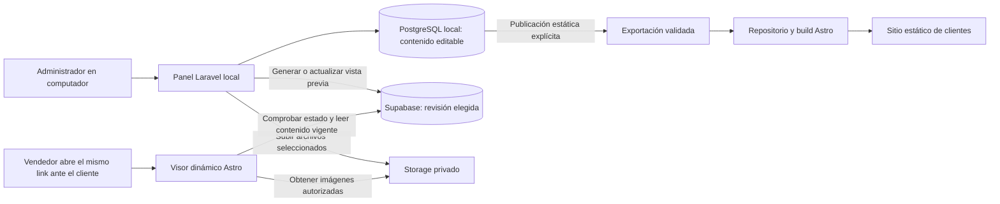

# ClickTap — Plan de integración de vistas previas con Supabase y Astro

Fecha: 11 de octubre de 2026. Estado: plan de desarrollo; integración aún no implementada.

## 1. Objetivo y decisiones confirmadas

Crear una función propia para preparar propuestas y abrir una vista previa dinámica de Astro mediante un link estable, para mostrarla presencialmente al cliente. El contenido editable permanece en PostgreSQL local. El panel envía a Supabase únicamente las revisiones elegidas. La publicación final conserva el proceso estático de Astro.

Decisiones del usuario:

- El panel Laravel/Filament continúa local durante esta fase de desarrollo.
- Supabase se incorpora primero para vistas previas, sin convertir las páginas de clientes en páginas dinámicas.
- La vista previa se abre mediante un link y se renderiza en Astro con el registro correspondiente de Supabase.
- El link de una vista previa se mantiene al actualizar su contenido. No se generan links nuevos por revisión.
- Las vistas previas no caducan automáticamente. El equipo decide cuándo suspenderlas y puede reactivarlas con el mismo link.
- El uso principal es abrir la página para mostrarla presencialmente; enviarla al cliente no es un paso obligatorio.
- PostgreSQL local sigue siendo la fuente del contenido editable.
- Los clientes existentes tienen páginas, enlaces, QR y NFC en uso. Sus direcciones y destinos deben conservarse.

La solicitud autoriza elaborar este plan. Crear cuentas, aplicar migraciones, implementar o desplegar corresponden a su ejecución posterior.

La política de link estable y desactivación manual fue aclarada por el usuario. Las revisiones del contenido son un detalle interno para confirmar envíos y recuperarse de fallos; no crean nuevas direcciones ni requieren que el usuario gestione links por versión.

## 2. Estado observado y diferencias con el diseño anterior

Repositorios inspeccionados:

- Panel: `C:/Users/vilun/OneDrive/Desktop/Proyectos GIT/docker-clicktap`.
- Astro: `C:/Users/vilun/OneDrive/Desktop/Proyectos GIT/Linktree/linktree-a-lo-weillo`.

| Componente | Situación comprobada | Implicación para la integración |
|---|---|---|
| Panel local | Docker escucha en `127.0.0.1:8080`; PostgreSQL local | En desarrollo se administra desde el computador |
| Crear página | `CreatePagina` crea también un local; el cliente es opcional | La propuesta comercial necesita un flujo que pueda existir antes de crear estos registros definitivos |
| Vista previa actual | `/preview/{pagina:slug}` usa Blade y requiere sesión | No es todavía el visor compartible de Astro |
| Editor | Contenido y enlaces vigentes en `paginas` y `enlaces_pagina` | Hace falta identificar revisiones y congelar lo enviado a una vista previa |
| Versiones históricas | Existen migraciones de `versiones_pagina` y una simplificación posterior | Auditar uso y datos antes de reutilizar tablas; no dar por activo el sistema de versiones antiguo |
| Publicación del panel | `PublicPagePublisher` envía un commit; `PublicPageExporter` incluye todas las páginas activas | La selección y confirmación de una publicación deben ser explícitas |
| Astro | Lock de Astro 7.3.5, `output: 'static'`, sin adaptador Cloudflare declarado | El visor dinámico necesita su propia configuración de ejecución |
| Entrada de datos en Astro | Rutas concretas importan `site.ts`, `barber.ts` y `barberia-cj.ts` | En esta copia no se encontró consumo de `src/data/generated/pages.json`; exportar desde el panel no demuestra integración de extremo a extremo |
| Plantilla pública | `LinkPage.astro` recibe `SiteProfile`; existen equipos, sucursales, transferencias, productos y un menú independiente | La conversión del contenido del panel requiere un contrato compatible; los clientes actuales no deben pasar por una conversión incompleta |
| Interfaz nueva | Incluye una demostración de navegación; el plan UI mantiene módulos funcionales pendientes | Los botones de la demostración no acreditan persistencia ni publicación reales |

La comprobación Git ordinaria de la carpeta Astro devolvió un error de árbol de trabajo. Antes de implementar se debe verificar el checkout, rama y repositorio realmente conectado a Cloudflare. No se ha confirmado que esta copia sea idéntica al despliegue en producción.

## 3. Arquitectura propuesta

Supabase guarda copias destinadas a visualización; no sincroniza todo el negocio ni recibe cobros, notas privadas o usuarios del panel. Cada envío tiene identificador, revisión y huella de contenido. La comunicación es saliente desde Laravel, por lo que el visor no necesita acceder al computador.

Guardar puede seguir funcionando sin Internet. Generar, actualizar, suspender o reactivar una vista previa remota necesita conexión. Una vista previa ya enviada puede abrirse con el computador apagado si el visor de Astro está alojado y los servicios remotos están disponibles.

Flujo de lectura: el panel crea un registro de vista previa en Supabase y obtiene su link estable. Cuando el vendedor abre ese link, Astro identifica el registro y renderiza su contenido actual. Si el panel envía cambios, se actualiza el contenido visible de esa misma vista previa. Al volver a abrir o recargar el mismo link se ve el contenido nuevo, sin otro despliegue. La actualización automática de una pestaña ya abierta no es un requisito de esta fase.

### Dos destinos Astro

1. **Sitio estático actual:** conserva sus rutas y su despliegue de producción.
2. **Visor dinámico de desarrollo:** configuración/build independiente que reutiliza la plantilla y estilos de Astro, con una ruta propuesta `/v/{token}`. Primero se ejecuta localmente; después puede alojarse en un Worker de pruebas y, opcionalmente, en `preview.clicktap.app` si se configura ese subdominio.

La URL del visor y el subdominio son propuestas, no recursos ya existentes. Alojar el visor no implica alojar el panel. Para probar desde un teléfono fuera de la red local será necesario alojar el visor o habilitar un acceso temporal explícito; Supabase por sí solo no hace pública una URL de Astro local.

El adaptador actual de Astro para Cloudflare ya no admite despliegues en Cloudflare Pages y dirige la ejecución dinámica a Workers. Se comprobarán las versiones compatibles antes de instalarlo; no se aplicará su configuración automáticamente al build estático de producción. [Documentación del adaptador](https://docs.astro.build/en/guides/integrations-guide/cloudflare/#removed-cloudflare-pages-support).

## 4. Protección de páginas y enlaces existentes

Inventario inicial de rutas deducido del código, pendiente de contrastar con las respuestas reales de producción:

| Ruta | Comportamiento en el código inspeccionado |
|---|---|
| `/` | Portada comercial |
| `/7E-barber-shop` | Perfil de 7E |
| `/7e-barber-shop` | Mismo perfil con otra capitalización |
| `/barberia-cj` | Perfil CJ |
| `/cj` | Redirección a `/barberia-cj/` |
| `/ignacio-parada` | Perfil personal |
| `/barbero` | Redirección a `/ignacio-parada/` |
| `/dona-flor-supermercado` | Perfil del negocio |
| `/botilleria-dona-flor` | Redirección a `/dona-flor-supermercado/` |
| `/bronto-pizza` | Perfil del negocio |
| `/el-bajon-del-marley` | Perfil del negocio |
| `/el_bajon_del_marley` | Mismo perfil con guiones bajos |
| `/flores-de-frida` | Perfil del negocio |
| `/full-drink` | Perfil del negocio |
| `/full-drink-juan-de-dios-rivera` | Redirección a `/full-drink` |
| `/la-dinastia-china` | Perfil del negocio |
| `/la-dinastia-china/menu` | Menú independiente con imágenes |

Antes de cambios al sitio público, capturar para estas rutas: respuesta HTTP, redirecciones y destino final, comportamiento con barra final, enlaces internos y externos, mensajes de WhatsApp, recursos y apariencia. Incluir las URLs efectivamente grabadas en tarjetas y QR cuando estén disponibles.

Las mayúsculas, guiones bajos y variantes existentes forman parte del inventario. No regenerar sus rutas desde el nombre comercial. Reservarlas frente a nuevas altas y conservar los alias con su comportamiento actual. La normalización para detectar colisiones no debe reescribir la URL histórica; las variantes de capitalización de un mismo cliente requieren tratarse juntas.

La primera prueba utiliza un negocio ficticio y el visor aislado. Ninguna prueba de integración exige publicar cambios en `clicktap.app`. Antes de una publicación futura se conservará un artefacto/despliegue recuperable y se repetirá el inventario de regresión.

## 5. Crear y preparar Supabase

1. Entrar al Dashboard de Supabase, crear o seleccionar la organización y crear un proyecto identificado como desarrollo, por ejemplo `clicktap-preview-dev`.
2. Elegir la región disponible más adecuada para los usuarios en Chile; registrar región y límites del plan elegido sin asumir gratuidad o disponibilidad permanente. Guardar la contraseña de base de datos fuera del repositorio.
3. Registrar el identificador del proyecto, Project URL y claves necesarias. Usar secretos exclusivamente en Laravel y en el entorno servidor del visor. No copiarlos al HTML, JavaScript del navegador o archivos versionados.
4. Versionar el esquema remoto y sus permisos mediante migraciones de Supabase en el repositorio del panel, que será su único propietario. Usar datos ficticios como seed. Las migraciones de Laravel siguen administrando la base local; no ejecutar indiscriminadamente esas migraciones sobre Supabase.
5. Crear tablas de vista previa y un bucket privado de imágenes. Configurar tipos y tamaños admitidos, grants y RLS. La lectura pública de tablas queda denegada; poseer la clave publicable no debe permitir enumerar vistas previas.
6. Conectar Laravel por HTTP a la Data API y Storage, usando su cliente HTTP existente. Esto conserva la conexión PostgreSQL local actual y evita cambiar las variables `DB_*` del panel.
7. Verificar con un registro ficticio: escritura desde servidor, lectura autorizada y rechazo de lectura anónima. Repetir las comprobaciones para las imágenes.
8. Antes de usarlo con clientes, crear un entorno remoto separado del proyecto de desarrollo y aplicar las mismas migraciones. Las pruebas y resets nunca apuntarán al proyecto de uso real.

Para esta arquitectura no hace falta incorporar Supabase Auth: el personal continúa autenticándose en Laravel y abre la vista previa mediante su link. La política de acceso y suspensión se implementa en el visor. Supabase proporciona la API de datos; no es necesario construir otra API CRUD completa. [API generada](https://supabase.com/features/auto-generated-rest-api), [claves](https://supabase.com/docs/guides/getting-started/api-keys), [grants y RLS](https://supabase.com/docs/guides/database/postgres/row-level-security).

Las claves secretas de Supabase tienen privilegios elevados y pueden omitir RLS: que estén en servidor no sustituye validar token, estado activo y pertenencia de la revisión en cada solicitud. El proyecto de vistas previas solo contendrá el contenido necesario para mostrarlas.

La separación de entornos y migraciones sigue el flujo documentado por Supabase. [Gestión de entornos](https://supabase.com/docs/guides/deployment/managing-environments).

## 6. Modelo de datos y contrato

Los nombres siguientes son propuestas para implementación; los identificadores serán UUID. La versión exacta del esquema se cerrará tras revisar las tablas existentes.

| Ubicación | Entidad propuesta | Contenido y responsabilidad |
|---|---|---|
| PostgreSQL local | Propuesta | Contenido editable de una demostración; puede existir sin cliente, local o página definitivos |
| PostgreSQL local | Revisión de contenido | Copia congelada, número, hash y versión del contrato; origen en propuesta o página existente |
| PostgreSQL local | Envío de vista previa | ID remoto, revisión solicitada/confirmada, estado, error e identificador idempotente |
| Supabase | `vistas_previas` | ID estable, hash del token estable, revisión visible, estado activa/suspendida y fechas de actualización/suspensión |
| Supabase | `revisiones_vista_previa` | ID, vista previa propietaria, contrato JSON validado, hash, número y fecha |
| Supabase / Storage | Recursos de revisión | Imágenes privadas identificadas por contenido y asociadas a una revisión |

El contrato será explícito y versionado: nombre, descripción, tema, colores admitidos, enlaces ordenados y recursos. Debe adaptarse a `SiteProfile`, no asumir que el JSON de `PaginaPublica` ya es compatible. Hoy hay diferencias en valores nulos, iconos, colores y comportamiento de copia/transferencia.

Primera entrega: perfil básico de un negocio ficticio con logo, contacto, enlaces, colores y copia de datos. Las secciones avanzadas de clientes existentes conservan sus datos actuales; incorporarlas al editor requerirá ampliar el contrato sin pérdida de campos. La misma revisión debe producir contenido equivalente en el visor y en su futura publicación estática.

La propuesta técnica usa un registro estable por vista previa, para que actualizar la demostración de un negocio no sustituya la de otro. Cada link identifica siempre ese mismo registro; el contenido visible puede cambiar. El token de acceso no es el slug definitivo y se conserva al actualizar o reactivar. La ruta definitiva se asigna o se conserva al crear/promover una página.

## 7. Flujo del panel

### Entrada A: Crear vista previa

1. Abrir una sección de propuestas/vistas previas, separada de Crear página.
2. Introducir nombre, plantilla, logo, descripción y enlaces. Guardar una propuesta local sin exigir cliente ni reservar la URL pública definitiva.
3. Pulsar **Generar vista previa**. Guardar la revisión, validar el contrato, preparar imágenes y crear su registro en Supabase con un link estable.
4. Mostrar progreso y luego **Abrir vista previa**, **Copiar link**, última actualización confirmada y disponibilidad. El vendedor abre la página en su teléfono para mostrarla. Un error de envío conserva la propuesta local y permite reintentar.
5. Al editar, guardar localmente y mostrar que hay cambios aún no enviados. **Actualizar vista previa** enviará el contenido nuevo al mismo registro visible. El link se conserva; basta abrirlo o recargarlo para ver los cambios.
6. Ofrecer **Suspender vista previa** y **Reactivar vista previa**. Mostrar el estado confirmado por Supabase; no anunciar una suspensión efectiva si falló la conexión. Actualizar contenido de una vista previa suspendida no la reactiva automáticamente.
7. **Convertir en página** copia una revisión elegida a una página/local definitivos, permite asociar cliente y valida el slug. Es una operación local transaccional e idempotente; convertir no publica. El link de demostración nunca se graba como dirección definitiva en NFC o QR.

La creación independiente de propuestas es la interpretación propuesta de la función propia solicitada. Permite demostrar un diseño antes del alta definitiva sin llenar la lista de páginas reales con propuestas descartadas.

### Entrada B: Crear o editar página

1. Conservar el acceso directo al formulario existente.
2. Guardar el contenido local con una revisión identificable.
3. Generar una vista previa de esa página mediante el mismo servicio; no necesita duplicar el editor ni el motor de renderizado.
4. Preparar y publicar de forma estática una revisión elegida mediante una acción separada.

Estados distintos: contenido local guardado/con cambios; envío pendiente/en curso/disponible/fallido; vista previa activa/suspendida; publicación sin enviar/enviada/confirmada/fallida. Crear una vista previa no cambia el estado de publicación del negocio.

### Administración de vistas previas

Agregar a la misma sección una lista con negocio/propuesta, link, estado, última actualización confirmada y acciones Abrir, Copiar link, Actualizar, Suspender y Reactivar. Suspender conserva el registro y el contenido, pero Astro deja de mostrar la propuesta y responde con una pantalla de vista previa no disponible. Reactivar recupera el mismo link. No hay renovación ni caducidad automática.

Dar de baja una página pública de cliente es otra operación: como su publicación sigue siendo estática, requiere modificar su estado y realizar un despliegue controlado conservando la URL. El control de suspensión de vistas previas no afectará páginas públicas existentes. Una eliminación permanente de propuestas no es necesaria para este primer flujo.

El nuevo trabajo funcional se vincula a las fases 7B–7D del plan UI: edición, vista previa y publicación. Reutiliza sus componentes y normas gráficas. Los flujos funcionales existentes y la nueva demostración de interfaz deben conectarse explícitamente, sin asumir que ya comparten persistencia.

## 8. Sincronización, links e imágenes

Cada envío congela una revisión y usa una clave idempotente. Subir primero los recursos; después persistir la revisión completa; por último activar su referencia dentro de una transacción remota. Un fallo no debe dejar visible una revisión a medias. La base local y Supabase no comparten transacción: registrar el trabajo y conciliar su resultado al reintentar, incluso si la respuesta se perdió después del éxito remoto.

Evitar que una respuesta antigua sobrescriba una revisión más nueva mediante comparación de revisión esperada. Comprobar que la revisión activada pertenece a la vista previa indicada. El trabajo de envío guardado permite reintentar tras reiniciar Docker; si se usa una cola de Laravel, documentar y levantar su worker local.

El link usa un token aleatorio de alta entropía creado una sola vez por vista previa. En Supabase se guarda su hash. Para volver a copiar el mismo link, el panel puede conservar el token cifrado localmente, protegido por la clave de Laravel; el respaldo debe permitir recuperar esa clave. Nunca registrar el token o las credenciales en logs de aplicación. Actualizar el contenido, suspender o reactivar no cambia el token.

El link permite abrir la vista previa a quien lo posea mientras esté activa; no exige una cuenta al vendedor en Astro. El visor comprueba el estado activo antes de resolver la revisión. Las respuestas llevan `Cache-Control: no-store`, `X-Robots-Tag: noindex, nofollow` y `Referrer-Policy: no-referrer`. La exclusión de buscadores complementa el control de acceso, no lo reemplaza. Configurar límites de solicitudes y redactar tokens de la observabilidad que se controle.

Las imágenes de borradores permanecen privadas. El visor puede servirlas mediante una ruta que revalide el token, opción preferida si la desactivación debe bloquear inmediatamente nuevas descargas. Como alternativa se pueden emitir URLs firmadas muy breves, documentando que siguen válidas hasta su vencimiento. [Buckets privados](https://supabase.com/docs/guides/storage/buckets/fundamentals), [vigencia de URLs firmadas](https://supabase.com/docs/guides/storage/serving/downloads).

Al publicar estáticamente, copiar las imágenes seleccionadas a recursos públicos con nombres por contenido. El HTML final no dependerá de URLs privadas temporales. Una limpieza posterior podrá eliminar revisiones antiguas y archivos sin referencias conforme a una política de retención explícita; debe conservar el contenido vigente de las vistas previas activas y suspendidas para permitir su reactivación. Suspender no borra contenido ni originales locales. El vencimiento técnico de una URL firmada de imagen no determina la duración del link de vista previa.

## 9. Conexión del visor Astro

1. Crear un build/entrada de visor independiente en el repositorio Astro y comprobar la compatibilidad del adaptador con Astro 7.3.5. Compartir `LinkPage.astro`, tipos y estilos con el sitio estático, evitando una segunda plantilla divergente.
2. Configurar secretos del proyecto Supabase de desarrollo en el entorno servidor del visor. No utilizar el prefijo `PUBLIC_` para claves secretas ni importarlas desde código cliente.
3. Implementar la ruta dinámica propuesta `/v/{token}`: validar token y estado, obtener la revisión activa por servidor, comprobar contrato y recursos, convertir a `SiteProfile` y renderizar la plantilla.
4. Implementar acceso autorizado a imágenes y una identificación visual de vista previa. Los cambios compartidos a la plantilla deben tener valores predeterminados que conserven las páginas actuales.
5. Para token inexistente o vista previa suspendida, mostrar un mensaje genérico de vista previa no disponible; para un fallo de servicio, responder como indisponibilidad temporal. No mostrar por defecto el negocio 7E ni datos de otra propuesta: `LinkPage` hoy tiene un perfil por defecto y la ruta dinámica debe suministrar siempre datos validados.
6. Ejecutar localmente contra Supabase de desarrollo y comprobar el runtime de Cloudflare. Un build de Astro exitoso no acredita por sí solo el control de acceso remoto.
7. Cuando se necesite la prueba compartible, alojar exclusivamente el visor en un Worker de pruebas con secretos del entorno correspondiente. Verificar desde otro dispositivo/red y con el panel detenido.

La ruta de Astro cumple la validación y lectura de la vista previa; no hace falta añadir una API pública genérica al panel. La base remota se consulta desde el servidor de Astro usando la Data API de Supabase. [Renderizado bajo demanda](https://docs.astro.build/en/guides/on-demand-rendering/).

## 10. Publicación final estática

La publicación conserva un paso explícito de exportación y despliegue. Supabase no cambia automáticamente las páginas públicas al guardar o actualizar una vista previa.

Para integrar realmente el panel con esta copia de Astro hay que añadir un consumidor del contrato exportado. El build reunirá las páginas históricas y las nuevas publicaciones seleccionadas; detectará colisiones antes de generar archivos. El contrato de vistas previas y el de exportación deben converger en un mismo adaptador de contenido.

Antes de activar publicaciones desde el panel, ajustar el exportador: publicar una revisión seleccionada e incluir las versiones ya publicadas de las demás páginas. El indicador `activo` no basta para decidir qué cambios enviar, porque el exportador actual podría arrastrar cambios guardados de otros negocios. Las páginas históricas todavía no gestionadas por el panel deben seguir generándose desde sus fuentes existentes.

Un commit enviado es estado **Enviada**, no **Publicada confirmada**. Confirmar el despliegue y la revisión servida mediante el identificador/hash esperado, comprobar la URL final y mantener disponible la referencia al despliegue anterior. Un rollback restaura la versión publicada sin cambiar la dirección del cliente.

La vista previa no implica aprobación comercial, cobro ni autorización de publicación. Esas reglas podrán conectarse después; no se inventan como condición de esta prueba técnica.

## 11. Fases de ejecución y criterios de cierre

| Fase | Trabajo | Resultado verificable |
|---|---|---|
| 0. Base e inventario | Verificar carpeta/rama vinculada, inventariar rutas y recursos, documentar despliegue vigente y reproducción local | Lista de rutas históricas y build base reproducible; ninguna discrepancia importante sin explicar |
| 1. Proyecto Supabase de desarrollo | Crear proyecto, migraciones, permisos, bucket y credenciales del entorno | Servidor escribe una muestra ficticia; cliente anónimo no enumera datos ni descarga archivos privados |
| 2. Contrato compartido | Definir revisión, JSON, adaptación a `SiteProfile` y archivos | Un mismo ejemplo se valida en Laravel y Astro y representa enlaces, colores y transferencias sin pérdida |
| 3. Visor Astro local | Entrada dinámica separada, token estable, lectura y recursos privados | Muestra la revisión remota correcta; rechaza links inválidos y vistas previas suspendidas; no usa datos de otro negocio |
| 4. Función en el panel | Propuestas, generar/actualizar, copiar link, suspender/reactivar, estados, reintentos y conversión a página | Recorrido completo con datos ficticios y link estable; guardar y previsualizar no publican |
| 5. Visor accesible de pruebas | Worker aislado y comprobación desde teléfono | Mismo link accesible desde otra red y con el panel apagado; actualización, suspensión y reactivación funcionan |
| 6. Integración de publicación estática | Consumidor del contrato, selección de revisiones, imágenes definitivas y confirmación de despliegue | Build de ensayo preserva todas las rutas históricas y excluye cambios no elegidos |
| 7. Preparación de uso real | Entorno remoto separado, límites/costos, respaldo, limpieza y recuperación comprobados | Prueba completa repetible, datos de desarrollo aislados y procedimiento de retorno documentado |

Orden: 0 → 1 → 2 → 3 → 4 → 5. La fase 6 puede prepararse después del contrato, pero cualquier despliegue del sitio público requiere cerrar la regresión de rutas. El primer hito útil es la fase 5: crear una propuesta local y abrir su vista previa de Astro en el teléfono para mostrarla al cliente sin publicar una página definitiva.

## 12. Pruebas que acreditan el resultado

- Una propuesta se guarda sin cliente/local/página definitivos; convertirla dos veces no duplica la página.
- La vista previa A nunca puede leer datos o archivos de B; no hay acceso anónimo de listado o escritura.
- Un token válido muestra exactamente la revisión enviada; guardar cambios locales no altera lo que ve el cliente.
- Actualizar conserva exactamente el mismo link; al abrirlo o recargarlo se muestra el contenido actualizado. Un envío viejo no reemplaza uno más nuevo.
- Suspender bloquea nuevas lecturas de la propuesta y sus imágenes; reactivar conserva el link y recupera el contenido. Ningún plazo de siete o treinta días desactiva la vista previa.
- Actualizar una vista previa suspendida conserva su suspensión. Una solicitud de contenido anterior a una suspensión no puede reactivarla al terminar.
- Una interrupción durante el envío conserva la revisión remota anterior; reintentar tras respuesta perdida no duplica registros.
- El visor alojado funciona desde un teléfono con el panel detenido; una falla de Supabase se presenta como indisponibilidad sin mostrar datos alternativos.
- El build estático de prueba incluye páginas anteriores y nuevas elegidas, conserva rutas/alias/destinos y no incluye propuestas o cambios ajenos.
- El sitio publicado no utiliza tokens de vista previa ni URLs de imágenes que caduquen; el cambio de contenido no requiere regrabar NFC o QR.
- La verificación de publicación distingue commit enviado, despliegue fallido y revisión confirmada; se puede regresar a una revisión anterior manteniendo la URL.

Se ejecutarán pruebas de Laravel de alcance específico, validación/build de Astro y pruebas HTTP/de navegador para acceso, renderizado y rutas. La suite normal de Laravel seguirá usando su base de pruebas y nunca la base personal. Este documento no registra pruebas ejecutadas de una integración que aún no existe.

## 13. Decisiones confirmadas, comprobaciones y límites del alcance

Confirmado: link estable al actualizar, vista previa dinámica desde Supabase, uso presencial para mostrarla y desactivación manual sin caducidad automática. La suspensión reversible y la reactivación con el mismo link concretan la administración solicitada. Propuestas operativas iniciales: visor en Worker aislado, subdominio opcional, retención de revisiones antiguas definida antes de automatizar su limpieza y datos ficticios durante desarrollo.

Por comprobar al implementar: repositorio/rama y proyecto Cloudflare de producción, configuración de redirecciones fuera del código, URLs de QR/NFC usadas, versión compatible del adaptador y contrato completo de las secciones avanzadas.

El alojamiento del panel, edición móvil remota, cuentas de clientes, cobros y migración de páginas públicas a Supabase quedan como evoluciones posteriores. Este plan complementa el flujo local y estático acordado y concreta la integración de vista previa mencionada en `docs/PLAN_IMPLEMENTACION_UI_MVP.md`.
