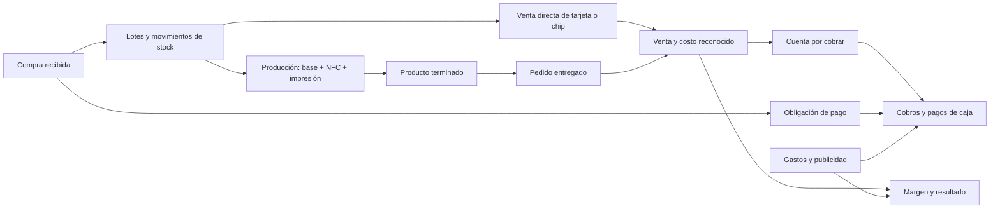

# ClickTap — Plan de Stock de tarjetas y Contabilidad

Fecha: 21 de octubre de 2026, America/Santiago. Estado: propuesta funcional y técnica para discusión; sin implementar migraciones, cargar datos reales ni desplegar servicios.

## 1. Decisión central y datos confirmados

Crear dos vistas en el panel Laravel/Filament existente, conectadas al mismo catálogo de productos, compras, pedidos y movimientos en Supabase. Una compra se registra una vez y alimenta ambas vistas. Separar inventario físico, compromiso comercial, cobro y resultado económico.

Datos entregados por el negocio:

- Aporte inicial: **$25.000 CLP**.
- Retorno de ventas de la primera inversión destinado a reinversión: **$89.000 CLP**. No es un segundo aporte de socios ni utilidad demostrada.
- Publicidad informada: **$3.000 CLP**. Falta confirmar si es adicional a los $89.000 y desde qué fondos se pagó.
- Inventario informado: **50 tarjetas Google, 20 acrílicos sin NFC y 50 chips NFC**.
- Los 20 acrílicos se personalizarán, requieren 20 de esos chips y tendrán gastos posteriores de impresión.
- Capacidad planificada: **20 acrílicos personalizados y 30 chips para venta individual**, además de las tarjetas Google, sujeto a confirmar que estas últimas no necesitan chips del mismo lote.

No cargar automáticamente todo como disponible: el conteo y la distribución actual entre vendido, reservado y en proceso todavía deben conciliarse. Tampoco suponer que las unidades informadas incluyen todo el histórico de la primera inversión.

## 2. Base existente verificada en el repositorio

| Pieza | Evidencia | Decisión propuesta |
|---|---|---|
| Panel | Laravel 13 y Filament 3 declarados; recursos de clientes, locales y páginas | Añadir navegación Stock de tarjetas y Contabilidad con el sistema visual actual |
| Conexión compartida | `src/config/database.php`, conexión `supabase`, esquema `clicktap`, SSL | Mantener una fuente central para operaciones del negocio |
| Copia local | `LocalCatalogSync::TABLES` contiene clientes, locales, páginas y enlaces; intervalo 1.200 segundos | No usar esta copia para decidir reservas, pagos ni existencia vendible |
| Placas | Migración `placas_nfc` con código, programación, pruebas y destino | Reutilizar como identidad técnica de una unidad NFC terminada; no como catálogo universal |
| Asignaciones | `asignaciones_placa` relaciona placa y local | Conservar trazabilidad de la entrega y asignación |
| Cobros | `cobros` exige local, guarda un monto y un estado de pago | Adaptar a pedidos, ventas sin local y abonos; no crear otro registro paralelo del mismo ingreso |
| Precios | `configuracion_precios` tiene valores globales de paquete/cambio | Mantener compatibilidad para servicios; introducir precios por SKU. Los valores por defecto no son precios comerciales confirmados |
| Auditoría | `eventos_auditoria` | Reutilizar, ampliando actor de sistema para integraciones |
| Publicación | `PublicPageExporter` exporta páginas públicas y `PublicPagePublisher` envía contenido a GitHub | Mantener inventario interno, comprobantes y finanzas fuera del contenido público |

Se revisaron archivos, no el estado ni los registros de producción en Supabase. Tener una migración no demuestra que esté aplicada o que una tabla esté vacía. Antes de implementar, revisar esquema efectivo, datos, restricciones y dependencias de borrado.

El plan de vistas previas del 11 de octubre describía PostgreSQL local como origen. El código y README posteriores ya contemplan escrituras en Supabase y copia local. Este plan sigue ese comportamiento actual y deberá comprobarse contra la configuración efectiva antes de migrar.

## 3. Vista: Stock de tarjetas

### Composición de pantalla

- Encabezado: título, buscador por producto/SKU/código/pedido, filtro por fecha y acciones **Registrar compra**, **Cargar inventario inicial**, **Crear pedido**.
- Indicadores: Disponible para vender, Reservado, En proceso, Vendido en el período. Cada indicador muestra desglose por producto para no mezclar insumos con productos terminados.
- Pestañas: **Inventario**, **Pedidos y reservas**, **Producción**, **Historial**.
- Inventario: producto, tipo, SKU, existencia física, reserva comercial, apartado para producción, disponible, costo registrado y alerta de reposición.
- Ficha de producto: lotes, costos, unidades identificadas, compras, composición, ventas e historial.
- Ficha de unidad terminada: código interno, destino/página opcional, programación y pruebas NFC/QR, pedido, cliente y recorrido completo.
- Historial: fecha efectiva, fecha de registro, operación, producto/lote/unidad, cantidad, origen y destino, costo, usuario, motivo y documento asociado. Filtros y exportación CSV.

Mantener tema claro, sidebar oscuro, Inter y estados con texto y color según `docs/NORMAS_GRAFICAS_CLICKTAP.md`. En móvil, mostrar producto, cantidad, estado y acción principal; trasladar el detalle al abrir la ficha. Estados vacíos, carga, error y conexión caída deben distinguirse de una existencia cero.

### Catálogo inicial y composición

| SKU propuesto | Artículo | Cantidad informada | Tratamiento inicial |
|---|---|---:|---|
| TAR-GOOGLE | Tarjeta Google | 50 | Producto comercial; confirmar si ya incluye NFC |
| ACR-BASE | Acrílico sin personalizar | 20 | Insumo para producción |
| NFC-CHIP | Chip NFC | 50 | Insumo y producto vendible: apartar 20 para acrílicos, dejar 30 libres |
| ACR-PERSONALIZADO | Acrílico personalizado con NFC | 0 terminado por confirmar | Producto fabricado; capacidad prevista de 20, no existencia terminada automática |

Receta inicial por unidad personalizada: **1 ACR-BASE + 1 NFC-CHIP + impresión personalizada**. La impresión se registra como servicio/costo directo de producción, salvo que se compre como material inventariable. Registrar además adhesivo, empaque y otros consumos cuando existan.

Apartar 20 chips no consume ni compra otros 20 chips. Si todavía no se ha ensamblado nada, hay 50 físicos: 20 apartados y 30 libres. Tras fabricar las 20 unidades sin pérdidas: 0 bases, 30 chips sueltos y 20 productos terminados. Los chips montados quedan trazados como componentes, no disponibles como chips independientes.

No mostrar «120 productos vendibles»: mezcla bases y chips destinados a ensamblaje. Si las tarjetas están listas, el objetivo comercial sería 50 tarjetas + 20 acrílicos terminados + 30 chips sueltos; esa capacidad no equivale al stock terminado actual.

### Estados y reglas

Separar dimensiones para evitar que «pagado», «vendido» y «entregado» compitan por una sola columna:

| Dimensión | Estados propuestos |
|---|---|
| Pedido | Borrador, reservado, confirmado, completado, cancelado |
| Preparación | Pendiente, en proceso, listo, entregado |
| Pago | Pendiente, parcial, pagado, reembolso parcial, reembolsado |
| Existencia | Libre, reservada para pedido, apartada para producción, en proceso, en revisión, baja |

En esta primera versión, **Vendido** contará unidades entregadas mediante una venta; pedidos confirmados pendientes de entrega se mostrarán aparte. Cobrar un anticipo no registra todavía la venta como entregada. El criterio es una convención de gestión propuesta y no una regla tributaria.

Flujo usual: Disponible → Reservado → En proceso → Listo → Entregado. También se permite vender una unidad ya lista sin producción y fabricar para stock sin cliente.

- Reserva: cantidad, pedido/cliente opcional, canal, vencimiento y responsable; prórroga y liberación con motivo. Duración configurable; no caducar automáticamente pedidos pagados o ya en fabricación sin revisión.
- Una unidad puede tener un pedido y una fase de preparación, pero se descuenta una sola vez de la disponibilidad. Al pasar a producción, se transfiere su asignación; no se restan dos reservas.
- Disponibilidad por SKU/lote = existencia apta en almacén menos asignaciones activas exclusivas a pedidos o producción. Material ya trasladado a proceso deja de formar parte de la existencia de almacén.
- Entrega: salida de producto terminado, reconocimiento del costo y registro de venta en una transacción. Puede existir saldo por cobrar.
- Cancelación: libera lo no consumido. Material ya personalizado pasa a evaluación/reutilización o pérdida; no reaparece como materia prima automáticamente.
- Devolución: entrada en revisión; inspección decide reincorporación o baja. Reembolso y retorno físico son operaciones relacionadas, pero independientes.
- Ajuste por conteo o merma: cantidad, motivo y responsable obligatorios. Nunca editar un total sin un movimiento que lo explique.
- Histórico vendido: mostrar unidades brutas, devoluciones y netas; permitir consultar una fecha de corte. Una devolución no borra la venta original.

Carga inicial manual o CSV con vista previa, validación de SKU/cantidades, identificador de importación y resumen antes de confirmar. No duplicar compras ya registradas al cargar saldos iniciales.

## 4. Vista: Contabilidad

### Objetivo y pantalla

La primera entrega será de **control financiero y rentabilidad de gestión**. Usar la etiqueta Contabilidad en el menú, mostrando por separado caja, ventas, costos e inversiones para que el negocio pueda explicar cada cifra.

- Filtro global de período y comparación con período anterior.
- Indicadores: caja conciliada, cobros recibidos, gastos del período, resultado de gestión, costo del inventario y cuentas por cobrar/pagar.
- Pestañas: **Resumen**, **Movimientos**, **Compras y costos**, **Proyección**. Aportes, retiros y transferencias se filtran dentro de Movimientos.
- Acciones: Registrar gasto, Registrar aporte/retiro, Registrar pago, Registrar compra, Conciliar caja.
- Cada movimiento: fecha efectiva, cuenta, entrada/salida, categoría, monto CLP, contraparte, medio de pago, pedido/compra/producción vinculados, responsable y comprobante privado.
- Gráficos: cobros y pagos por semana; margen por producto; composición de gastos. No mostrar un gráfico concluyente si faltan costos: señalar cobertura y cifras provisionales.

### Cómo registrar los montos informados

| Hecho | Registro propuesto | Precaución |
|---|---|---|
| $25.000 iniciales | Aporte del propietario a caja o compra pagada por él, según evidencia | Registrar el aporte una sola vez; confirmar fecha, aportante y destino |
| $89.000 de retorno | Cobros de ventas de la primera etapa; ventas y costos asociados deben reconstruirse | No registrarlos como nuevo aporte ni como utilidad neta |
| Reinversión de $89.000 | Compra de inventario y pago según comprobante real | El dinero pasa de caja a inventario; no se genera un segundo ingreso |
| $3.000 de publicidad | Gasto de publicidad y pago, o deuda si no se pagó | Confirmar si está dentro de los $89.000 o es adicional y quién lo financió |
| Impresión pendiente | Costo presupuestado en proyección; costo real de fabricación al incurrir | No restarlo de caja antes del pago ni darlo por cero |

**$117.000 no es capital aportado ni saldo de caja**: sumar aporte y dinero reciclado mezcla conceptos. El aporte conocido es $25.000. La diferencia $89.000 − $25.000 = $64.000 tampoco demuestra utilidad, porque falta reconstruir costos vendidos, stock remanente y demás gastos.

Comprobación condicional: si se gastaron íntegros los $25.000 iniciales, se cobraron exactamente $89.000, se reinvirtieron íntegros esos $89.000 y además se pagaron $3.000 de publicidad, faltaría identificar $3.000 de financiamiento o una partida diferente. No registrar un aporte nuevo inventado ni declarar esa diferencia como saldo real.

### Costos, caja y utilidad

- Compra recibida: aumenta inventario al costo. Su pago reduce caja; comprar a crédito genera deuda.
- Material transformado: transfiere costo desde insumos hacia producción y producto terminado.
- Venta entregada: registra ingreso de gestión y costo del producto vendido. Cobrar antes o después afecta caja y saldo pendiente.
- Publicidad, comisiones, transporte de venta y suscripciones: categorías separadas. Los costos necesarios para adquirir/preparar inventario se distinguen de gastos comerciales.
- Aportes, préstamos, retiros y transferencias entre cuentas: separados de ingresos y gastos operativos. Un traspaso de cuenta no es otra venta.
- Pago hecho por un socio: clasificar como aporte o cuenta por pagar al socio; no fingir salida de la caja empresarial.

Para el MVP, proponer costo por lote con consumo FIFO de insumos y costo específico de cada fabricación. Guardar la asignación de costo usada al vender: una nueva compra no debe cambiar retroactivamente el margen de ventas anteriores. Registrar transporte de compra mediante un criterio de reparto visible, inicialmente proporcional al valor de cada línea; los redondeos deben conservar el total.

La distinción entre costo de inventario y gasto al vender se apoya en [IAS 2 — Inventories](https://www.ifrs.org/issued-standards/list-of-standards/ias-2-inventories/). Se usa como referencia conceptual; este panel no determina por sí solo el régimen tributario aplicable.

Costo de acrílico = base + chip realmente consumido + impresión + otros costos directos asignados. Mostrar también minutos de trabajo y un costo de mano de obra estimado para fijar precios. Distinguir ese tiempo propio estimado de salarios o servicios efectivamente pagados.

Si no hay desglose de una compra, guardar costo pendiente o provisional, con origen de la estimación. No repartir $89.000 entre las 120 piezas como si todas fueran equivalentes, ni convertir costos desconocidos en cero.

### Proyección útil desde el inicio

Mostrar **potencial del stock** y **pronóstico de ventas** por separado: tener unidades no acredita demanda. Escenarios editables conservador/base/alto, inicialmente sin probabilidades inventadas, con cantidades, plazo, precio, descuentos, comisiones, costos pendientes y calendario de cobro.

Si las 50 tarjetas ya incorporan NFC y no hay reservas/ventas previas, el techo comercial planificado puede expresarse así:

`Ingreso potencial = 50 × precio_tarjeta + 20 × precio_acrílico_personalizado + 30 × precio_chip`

La parte de acrílicos requiere completar impresión/ensamblaje. Restar cualquier unidad ya vendida o comprometida que no pertenezca al escenario; si las tarjetas consumen chips del mismo lote, rehacer el cálculo con la restricción compartida. No contar el mismo chip en dos productos proyectados.

- Ventas netas de gestión = ventas reconocidas − descuentos − devoluciones; tratar impuestos por separado cuando corresponda.
- Margen bruto = ventas netas − costo de unidades vendidas.
- Contribución = margen bruto − comisiones − empaque/despacho variable no incluido previamente en el costo.
- Resultado de gestión = contribución − publicidad − gastos fijos − otras pérdidas reconocidas.
- Caja futura = caja conciliada + cobros esperados + financiamiento confirmado − pagos programados − retiros.
- Punto de equilibrio = gastos fijos del período / contribución unitaria positiva. Con varios productos, usar una mezcla explícita; con contribución no positiva no existe un punto finito con esa hipótesis.

Identificar en cada costo si ya está incluido para evitar descontarlo dos veces. El resultado proyectado se rotula antes de impuestos y sujeto a datos completos. No puede calcularse todavía un monto fiable sin precios, desglose de compra, impresión y gastos de venta.

### Integrar ahora y dejar para después

Prioridad inmediata: caja separada del dinero personal, aportes/retiros por socio, comprobantes, costos completos por producto, abonos y deudas, cierres mensuales, conciliación semanal, historial de correcciones y exportación para revisión contable.

Para publicidad: registrar los $3.000 con fecha/campaña, consultas recibidas y ventas atribuidas manualmente. Mostrar costo por cliente adquirido y margen después de publicidad; si todavía no hay clientes atribuidos, mostrar «sin conversiones» en lugar de dividir por cero.

Agregar umbral de reposición, plazo del proveedor, presupuesto para impresión y reserva de caja configurable. No proponer porcentajes de reinversión sin conocer margen y necesidades reales.

Dejar para una fase posterior: emisión tributaria automática, integración bancaria, remuneraciones, contabilidad formal completa, predicción estadística y automatizaciones de canales. Preparar campos de proveedor/RUT, documento, folio, fecha, neto/impuesto/total y adjunto, sin suponer crédito fiscal recuperable.

Antes de decidir esperar para formalizar, revisar la fecha efectiva de inicio: el [SII indica el aviso dentro de los dos meses siguientes al mes en que comenzaron las actividades](https://www.sii.cl/destacados/educacion/ciclo_vida_contribuyente/paso_02.html). La planificación del panel no determina que se pueda postergar ese trámite.

## 5. Modelo de datos compartido

Nombres orientativos para implementación; usar UUID, claves foráneas y convenciones existentes. Totales monetarios CLP enteros; cálculos de costo con decimal exacto y reparto explícito de redondeo, nunca coma flotante binaria. Fechas técnicas UTC y presentación/cortes en America/Santiago; conservar fecha del comprobante.

| Entidad | Responsabilidad |
|---|---|
| `productos` | SKU único, nombre, tipo, vendible, inventariable, unidad, precio, stock mínimo, activo |
| `compras` / `compra_items` | Proveedor, documento, cantidades, importes y costos de adquisición |
| `lotes_inventario` | Producto, origen de compra/apertura, costo, recepción y trazabilidad |
| `movimientos_inventario` | Entradas, traslados, consumos, salidas y reversiones; cantidad/costo/origen/destino/operación |
| `reservas_inventario` | Asignaciones exclusivas a pedido o producción, cantidad pendiente, vencimiento y liberación |
| `pedidos` / `pedido_items` | Canal, cliente opcional, productos, precio/descuento congelados, entregas y costos asignados |
| `producciones` / `produccion_items` | Insumos/lotes consumidos, unidades obtenidas, impresión, pérdidas y costo transferido |
| `receta_items` | Componentes esperados por producto; creación en la fase de producción |
| `cuentas` / `movimientos_financieros` | Caja, banco y fondos en tránsito; cobros, pagos, aportes, retiros y transferencias |
| `gastos` | Categoría, obligación, fecha, monto, comprobante y vínculo opcional con campaña/producción |
| `cobros` existente + `aplicaciones_pago` | Obligación de cobro y aplicación de uno o varios movimientos a cobros/compras/gastos |
| `placas_nfc` / `asignaciones_placa` existentes | Unidad terminada serializada, página/local y pruebas técnicas |
| `eventos_auditoria` existente | Actor humano o sistema, operación, motivo y cambios |

`aplicaciones_pago` tendrá relaciones controladas con destinos válidos; un pago puede aplicarse parcialmente sin duplicar el movimiento de caja. El estado de cobro se deriva del monto exigible menos pagos y reversiones aplicados. No mantener `cobros.pagado_en` como segunda fuente independiente de dinero; adaptar su significado para compatibilidad.

Relacionar cada placa con su producto/lote o producción y, cuando corresponda, pedido. No crear placas por cada insumo genérico. Una venta de chips puede existir sin local ni página: adaptar la obligatoriedad actual de `cobros.local_id` sin perder registros previos.

Reglas de integridad:

- Los saldos son resultado de movimientos. Puede mantenerse un saldo materializado para bloqueo eficiente, actualizado en la misma transacción y reconciliable con el historial.
- Cantidades positivas por línea; tipo y origen/destino determinan el sentido. Sin stock disponible negativo ni asignaciones superiores a existencia apta.
- Un movimiento contabilizado no se elimina: corrección mediante reversión vinculada. Borradores sí pueden editarse.
- Las claves de operaciones e importaciones son únicas. Reintentar no repite cobros, entregas ni consumos.
- Referencias financieras e históricas no se borran en cascada con un cliente/local/producto. Auditar y corregir las cascadas actuales antes de conectar estos módulos.
- Cierre mensual bloquea cambios retroactivos salvo reapertura autorizada con auditoría. Mostrar impacto de correcciones de costos pendientes.

El diagrama expresa relaciones; recibir stock, incurrir en un costo y pagarlo pueden ocurrir en fechas distintas.

## 6. Supabase y despliegue con Cloudflare

### Etapa inicial recomendada

1. Mantener las dos vistas en Laravel/Filament, ejecutado en Docker local.
2. Usar PostgreSQL de Supabase como fuente central de inventario y finanzas. Conexión del servidor por SSL; para Laravel persistente, revisar conexión directa o pooler de sesión según conectividad. [Guía oficial Supabase/Laravel](https://supabase.com/docs/guides/getting-started/quickstarts/laravel).
3. Leer y escribir operaciones críticas por la misma conexión remota dentro de una transacción. Bloquear saldos/lotes al reservar o consumir; usar orden de bloqueo consistente y reintento acotado de conflictos.
4. No aplicar `UsesCatalogConnection` automáticamente a las nuevas entidades ni incorporar sus tablas al sincronizador de catálogo actual. Relaciones con clientes/locales consultadas en operaciones deben resolverse también remotamente.
5. Mantener esquema `clicktap` privado y fuera de Data API como prevé `PrepareSharedDatabase`. Rol de ejecución con permisos mínimos separado del rol de migraciones; autorización por acciones en Laravel. Si más adelante se expone alguna API Supabase, diseñar permisos y RLS explícitos para esa API. Las credenciales privilegiadas nunca van al navegador.
6. Comprobantes en almacenamiento privado con enlaces temporales y autorización; no usar el disco público de logos para documentos financieros.
7. Sin conexión: indicar que no se puede confirmar una operación. Ante respuesta perdida, consultar la clave de operación antes de reintentar. No anunciar éxito por haber cambiado una pantalla local.

### Papel de Cloudflare

El sitio público Astro y el panel administrativo son despliegues distintos. Mantener el flujo actual del sitio público en Cloudflare. Cambiar stock o registrar un gasto no debe generar un commit ni reconstruir páginas públicas.

Cloudflare Pages/Workers no es un alojamiento directo del stack PHP-FPM/Laravel/Filament existente; su [runtime documenta otros lenguajes y WebAssembly](https://developers.cloudflare.com/workers/languages/). Por eso se propone conservar el backend PHP y usar Cloudflare para el sitio y, cuando corresponda, el acceso y los puntos de integración.

Para acceder al panel desde fuera durante el inicio, opción separada: Cloudflare Tunnel con Access delante del login Laravel. [Tunnel conecta un servidor de origen a Cloudflare](https://developers.cloudflare.com/cloudflare-one/networks/connectors/cloudflare-tunnel/); no traslada su ejecución a la nube. Con el computador apagado el panel y sus trabajos locales no funcionan.

Antes de sincronización automática multicanal: alojar Laravel y un trabajador de colas en un servidor PHP siempre disponible detrás de Cloudflare. Esa es la opción principal propuesta para reutilizar reglas sin duplicarlas. Un Worker receptor y una cola duradera son una alternativa a evaluar, pero no garantizan actualización de stock mientras el procesador esté apagado; requieren retención, reintentos y alertas definidos.

No mezclar autenticación de Laravel con Supabase Auth por defecto. Supabase es aquí el servidor PostgreSQL compartido. Un frontend administrativo completamente nuevo en Workers sería otro proyecto y no es necesario para estas dos vistas.

### Puesta en producción prevista

- Ambiente de prueba con datos ficticios; no enviar webhooks de prueba contra producción.
- Inventario y caja conciliados a una fecha de corte; decidir reconstrucción histórica o apertura documentada. Nunca importar ambos para las mismas operaciones.
- Respaldo remoto y de documentos, con restauración probada. Los scripts actuales de PostgreSQL local no acreditan por sí solos respaldo de Supabase.
- Migraciones aditivas revisadas, importación idempotente, cotejo de saldos y activación por módulo.
- Rollback de aplicación sin borrar movimientos nuevos; migraciones de datos correctivas si fuera necesario.
- Comprobar conexiones, errores, colas y costos reales de servicio antes de contratar o desplegar. No se presupone que todos los servicios sean gratuitos.

## 7. Integraciones futuras de ventas

Desde el MVP cada pedido tendrá canal: directo, WhatsApp, Mercado Libre y Marketplace. Por ahora se registran manualmente con referencia externa opcional.

| Canal | Primera entrega | Automatización posterior |
|---|---|---|
| Mercado Libre | Pedido y comisiones ingresados manualmente | OAuth, mapeo SKU/publicación/variación, notificaciones de órdenes, consulta del estado real, reservas, cancelaciones y actualización de cantidades |
| WhatsApp Business | Pedido manual desde una conversación; catálogo y referencia | Evaluar WhatsApp Business Platform/Cloud API, cuenta, permisos, catálogo y webhooks. Una conversación o carrito no acredita pago |
| Marketplace | Asumido provisionalmente Facebook Marketplace: registro manual de pedido y enlace | Verificar producto/API, elegibilidad y permisos reales antes de prometer sincronización; catálogo de Meta no equivale automáticamente a publicaciones personales de Marketplace |

Mercado Libre documenta notificaciones `orders_v2` y consulta posterior del recurso: [notificaciones oficiales](https://developers.mercadolibre.cl/es_ar/publica-productos/productos-recibe-notificaciones). WhatsApp ofrece webhooks en su plataforma para negocios: [documentación oficial publicada por Meta](https://www.postman.com/meta/whatsapp-business-platform/folder/lboq68h/webhooks). La disponibilidad efectiva para las cuentas del negocio aún no se verificó.

En esta fase agregar `canales`, `publicaciones_canal`, `eventos_integracion` y una bandeja de salida transaccional. Guardar canal/cuenta/ID externo, recurso, versión o estado observado, intentos y último error. No usar solamente el ID del pedido para deduplicar eventos: un mismo pedido puede tener cambios legítimos.

El receptor verifica autenticidad según cada proveedor, persiste el evento y responde; el procesador consulta el estado autorizado y aplica operaciones idempotentes. Tratar reintentos y eventos fuera de orden. Claves únicas por cuenta/canal/pedido externo; deduplicación por entrega/evento y transición aplicable. Evitar registrar tokens o datos personales innecesarios en logs.

Supabase será la autoridad del stock interno. La actualización de canales externos es eventual: mostrar última sincronización, pendiente/error y conciliación periódica. Cuando varios canales comparten inventario, usar cuotas o margen de seguridad configurable para reducir sobreventa durante retrasos. Una consulta de disponibilidad pública es informativa; una reserva confirmada debe ser transaccional.

## 8. Orden de implementación y aceptación

| Fase | Entrega | Comprobación de salida |
|---|---|---|
| 0. Conciliación | Costos, compras, ventas anteriores, aporte y publicidad; estado real del inventario | Los $89.000 aparecen como retorno/reinversión, no como aporte adicional; saldos iniciales explicables |
| 1. Catálogo y stock | SKUs, lotes, carga inicial, reservas, ajustes e historial | 50 chips físicos pueden mostrar 20 apartados y 30 libres; importar dos veces no duplica |
| 2. Producción y pedidos | Acrílicos, consumo, impresión, entregas y devoluciones | Una fabricación consume una base y un chip una sola vez; terminado conserva su costo y trazabilidad |
| 3. Contabilidad | Compras/pagos, gastos, aportes/retiros, abonos, conciliación y margen | La compra alimenta stock y deuda/pago sin duplicar gasto; caja y cuentas pendientes cuadran |
| 4. Proyecciones | Precios, escenarios, capacidad limitada por componentes y presupuesto de impresión | No se cuenta un chip como venta individual y componente a la vez; costo desconocido queda visible |
| 5. Canales | Infraestructura disponible, Mercado Libre y luego WhatsApp; Marketplace condicionado | Repetir eventos no duplica venta/pago; cancelación libera stock; fallos quedan pendientes y recuperables |

Diseñar las relaciones compartidas desde el principio, implementando las tablas de cada fase cuando se usen. No es necesario construir todas las integraciones para operar las dos vistas.

Pruebas prioritarias al implementar: dos reservas simultáneas por la última unidad; entrega cobrada parcialmente; devolución y reembolso independientes; cancelación con material consumido; redondeo de costos; compra a crédito; gasto pagado por socio; reintento después de respuesta perdida; permisos y conservación del historial al archivar clientes. Probar concurrencia/restricciones en PostgreSQL de pruebas, no sólo SQLite. Comprobar UI móvil y que ninguna cifra privada termine en la exportación pública.

## 9. Información que falta para fijar cifras y cerrar reglas

1. Confirmar si las 50 tarjetas Google ya incorporan NFC o requieren chips adicionales.
2. Comprobante/desglose de los $89.000: artículos, cantidades, transporte y otros cargos; confirmar pago total y recepción.
3. Confirmar si los $3.000 están incluidos en esa suma, cuándo se pagaron y desde qué fondos.
4. Precios por tarjeta, acrílico y chip; descuentos; costo de impresión por unidad/lote; despacho, empaque y comisiones previstas.
5. Ventas/costos de la primera etapa y stock residual; caja actual; deudas; unidades ya reservadas o en producción.
6. Fechas reales y aportantes; política de abono, vencimiento de reservas y entrega a crédito.
7. Confirmar qué servicio se entiende por Marketplace y las cuentas que se conectarán.

Estas preguntas no impiden diseñar las pantallas. Sí impiden declarar utilidad real, caja disponible o proyección monetaria confiable.
